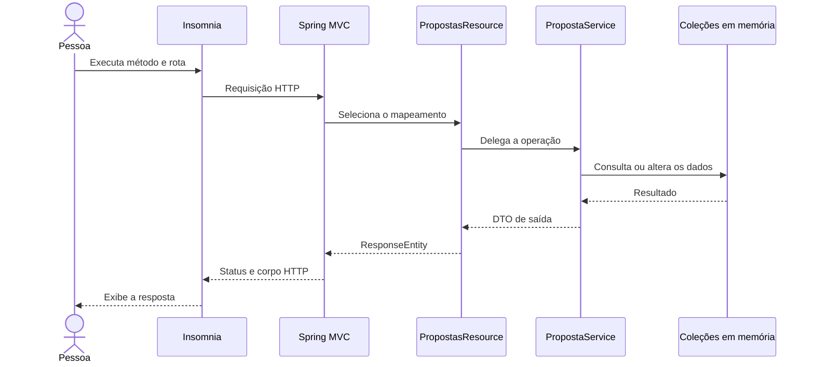

# Tutorial 1 — Contrato REST e Insomnia

## Missão

Implementar os primeiros endpoints REST de propostas da Fatec Antonio Brambilla a partir do contrato. Ao terminar, você terá controllers, validação HTTP e uma coleção Insomnia para percorrer o CRUD, filtros, catálogos e curtidas. Nesta etapa os dados ficam em memória; a etapa JPA substituirá o armazenamento.

## Antes de começar

- JDK 17 instalado.
- Insomnia instalado.
- Repositório clonado e terminal aberto na raiz.

Este roteiro descreve a branch `feature/01-rest-controllers`, que mantém os dados em coleções Java. Confira sua branch com `git branch --show-current`. Na versão com JPA, o controller está em `infrastructure/web/rest/controller`, os dados ficam no H2 e não há proposta inicial: crie uma antes de consultar seu ID. Você pode praticar o contrato na versão atual, observando essas diferenças.

## 1. Inicie a API

No Linux/macOS, execute `./gradlew bootRun`; no Windows PowerShell, execute `.\gradlew.bat bootRun`. Mantenha esse terminal aberto enquanto usa o Insomnia; `Ctrl+C` encerra a aplicação. Na branch desta etapa, o recurso principal fica em `src/main/java/br/com/fatecararas/piapi/resources/PropostasResource.java`; os catálogos ficam em `CatalogosResource`. A aplicação começa com uma proposta demonstrativa e listas de referência para que você possa experimentar as requisições sem configurar um banco.

## 2. Importe a coleção

No Insomnia, use **Import** e selecione `insomnia/propostas-insomnia.json`. A coleção inclui listagem e filtros, detalhe, criação, atualização, remoção lógica, curtidas e leitura dos catálogos. Execute as chamadas e observe o status e o corpo de resposta.

### Ordem sugerida das chamadas

Confira `base_url` no ambiente da coleção: `http://localhost:8080`. Os exemplos de corpo usam IDs dos catálogos; confirme-os antes de criar uma proposta.

| Ordem | Chamada | O que conferir |
|---|---|---|
| 1 | GET nos três catálogos | `200` e IDs disponíveis |
| 2 | POST de proposta | `201`, corpo com `id` e cabeçalho `Location` |
| 3 | Atualize `proposta_id` no ambiente da coleção | Use o ID retornado, sem presumir que será 1 |
| 4 | GET de detalhe e listagem | `200`; a proposta aparece em `conteudo` |
| 5 | PUT da proposta com todos os campos editáveis | `200` e valores alterados |
| 6 | PUT de curtida duas vezes e DELETE de curtida | `200`; contador passa a 1, permanece 1 e volta a 0 |
| 7 | DELETE da proposta e GET do mesmo ID | `204` sem corpo; depois `404` |

Arquive por último: uma proposta arquivada não fica disponível para edição ou curtidas. Os filtros da coleção podem estar desabilitados; habilite um por vez para entender o efeito. Uma página vazia retorna `200` com `conteudo: []`, não `404`.

## 3. Leia o controller

`@RestController` registra um controller que escreve respostas HTTP; `@RequestMapping` define o prefixo da rota; cada anotação `@GetMapping`, `@PostMapping`, `@PutMapping` ou `@DeleteMapping` associa um verbo à operação. `PropostasResource` delega regras ao `PropostaService`; não guarda estado HTTP nem dados diretamente no controller.

| Operação | Verbo | Rota | Uso esperado |
|---|---|---|---|
| Listar | GET | `/api/propostas` | Obter página de propostas; aceita filtros |
| Consultar uma | GET | `/api/propostas/{id}` | Obter uma proposta |
| Criar | POST | `/api/propostas` | Enviar uma nova proposta |
| Atualizar | PUT | `/api/propostas/{id}` | Atualizar os campos editáveis |
| Arquivar | DELETE | `/api/propostas/{id}` | Retirar da listagem pública sem apagar o histórico |
| Curtir | PUT | `/api/propostas/{id}/curtida` | Registrar uma curtida do usuário demonstrativo |
| Remover curtida | DELETE | `/api/propostas/{id}/curtida` | Desfazer a própria curtida |

Os filtros iniciais são `q`, `categoriaId`, `publicoAlvoId`, `cursoId`, `status` e `page`. `q` busca título, resumo e descrição. Cada página contém até 10 propostas. Públicos-alvo são selecionados de uma lista controlada. A definição de atributos, relações e regras está em [00-modelo-dados.md](00-modelo-dados.md). O conteúdo de criação e atualização usa esse modelo e a coleção como referência.

## O caminho de uma requisição

## 4. Experimente e registre

Escolha três chamadas da coleção e anote método, caminho, parâmetros, JSON de entrada e resposta de sucesso. Observe que públicos-alvo são escolhidos por ID no catálogo e que cada página contém até 10 propostas. Discuta por que curtida usa um recurso próprio e por que excluir uma proposta significa arquivá-la.

As listas de cursos, categorias e públicos-alvo e a proposta inicial são dados demonstrativos em memória. Nesta etapa, todas as chamadas de escrita usam um usuário demonstrativo; não há login nem controle de acesso até a etapa Spring Security. Reiniciar a aplicação restaura os dados iniciais.

### Se algo não funcionar

| Sintoma | Verificação |
|---|---|
| Conexão recusada | Confira se `bootRun` continua ativo e se a porta é 8080 |
| `404` no detalhe | Confira `proposta_id`, crie a proposta e não a arquive antes da consulta |
| `400` na criação | Selecione corpo JSON, confira os campos e use IDs reais dos catálogos |
| `415` | Confira o cabeçalho `Content-Type: application/json` |
| Lista vazia inesperada | Desabilite filtros e volte para `page=0` |

## Desafio

Revise o contrato com outra dupla. Confirme se os nomes dos campos são claros, se é possível descobrir as propostas por categoria, conteúdo, público-alvo e curso, e se os status HTTP esperados estão registrados. Leve as decisões para a etapa de implementação.

## Pronto quando

- A aplicação inicia e a coleção importa no Insomnia.
- As operações retornam os status previstos no modelo de dados.
- O grupo consegue explicar verbo HTTP, caminho, identificador e filtros.
- O modelo e os exemplos de JSON refletem a Fatec Antonio Brambilla.
- A turma registra dúvidas sobre validações e códigos de resposta para resolver na implementação.

---

[Roteiro da disciplina](../README.md#roteiro-da-disciplina) · [Anterior: tutorial 0](00-modelo-dados.md) · [Próximo: tutorial 2](02-jpa-persistencia.md)
