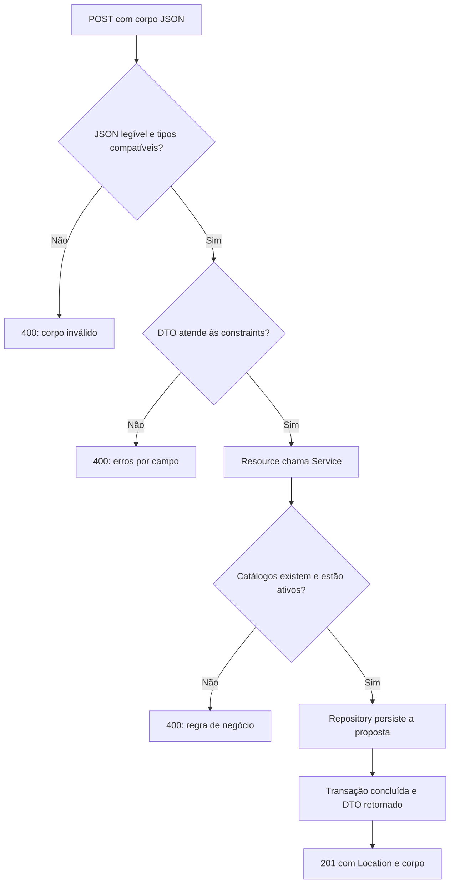

# Tutorial 3 — Requisições HTTP, camadas e validação

> **Status:** tutorial planejado no roteiro da disciplina.

## Missão

Depois de reproduzir a [persistência com JPA](02-jpa-persistencia.md), conecte a camada de dados às requisições da API. Este roteiro acompanha a branch `feature/03-resources-validation` e prepara a [documentação com Swagger](04-openapi-swagger.md), que continua sendo a próxima etapa.

Reproduza individualmente e de forma assíncrona o fluxo demonstrado ao vivo. Ao final, você deverá explicar onde entram os dados, quem valida cada regra, quem acessa o banco e como a resposta chega ao cliente. Não vamos alterar o contrato, adicionar autenticação ou configurar Swagger aqui.

O status planejado refere-se ao roteiro da disciplina; a branch indicada já contém o código de referência.

## Neste tutorial

- [1. Prepare o projeto e organize os pacotes](#1-prepare-o-projeto-e-organize-os-pacotes)
- [2. Entenda o caminho completo](#2-entenda-o-caminho-completo)
- [3. Repository Pattern: acesso aos dados](#3-repository-pattern-acesso-aos-dados)
- [4. DTOs: contrato de entrada e saída](#4-dtos-contrato-de-entrada-e-saída)
- [5. Service Layer: regras e transações](#5-service-layer-regras-e-transações)
- [6. Resources: ligação entre HTTP e aplicação](#6-resources-ligação-entre-http-e-aplicação)
- [7. Validação e tradução de erros](#7-validação-e-tradução-de-erros)
- [8. Reproduza as requisições](#8-reproduza-as-requisições)
- [9. Desafio individual e conclusão](#9-desafio-individual-e-conclusão)

## 1. Prepare o projeto e organize os pacotes

Use JDK 17 e o Gradle Wrapper do repositório. O tutorial anterior deve estar concluído: entidades, repositories, migrations, H2 e testes de persistência. As dependências `spring-boot-starter-webmvc` e `spring-boot-starter-validation` já estão em `build.gradle`; mantenha-as junto com JPA, Flyway e Lombok. Não é necessário adicionar uma dependência Swagger nesta etapa.

Se você está reproduzindo a partir da etapa anterior, mova os arquivos pela refatoração da IDE e atualize seus imports. Se já abriu esta branch, apenas confira a organização. Todos os pacotes abaixo têm o prefixo `br.com.fatecararas.piapi`:

| Origem anterior | Destino atual | Arquivos |
|---|---|---|
| `api.dto` | `application.dto` | Os cinco records de entrada e saída |
| `domain` | `application.service` | PropostaService e CatalogoService |
| `domain` | `domain.model` | StatusProposta e PerfilUsuario |
| `domain` | `domain.exception` | RecursoNaoEncontradoException e RequisicaoInvalidaException |
| `resources` | `infrastructure.web.rest.controller` | PropostasResource e CatalogosResource |
| `resources` | `infrastructure.web.rest.exception` | ApiExceptionHandler |

`domain.entity` e `domain.repository` continuam nos mesmos pacotes. Atualize também os imports dos enums nas entidades. Não mantenha cópias dos controllers antigos: duas classes registrando a mesma rota podem impedir a inicialização. Todos os pacotes continuam abaixo do pacote de `Main`, onde o Spring Boot inicia a descoberta dos componentes.

Esta organização expressa responsabilidades. Não constitui, por si só, uma implementação completa de arquitetura hexagonal ou Clean Architecture: nossos repositories ainda estendem interfaces Spring Data e nossos DTOs de entrada contêm constraints de Jakarta Validation.

## 2. Entenda o caminho completo

```text
Cliente HTTP
  → Spring MVC: encontra a rota, converte JSON/parâmetros e valida o DTO
  → Resource: recebe a entrada e chama o caso de uso
  → Service: aplica regras e coordena uma transação
  → Repository: consulta e persiste entidades via JPA/Hibernate
  → Banco
  → Service: transforma entidades em DTO de saída
  → Resource: define status, cabeçalhos e corpo
  → Spring MVC: serializa o DTO como JSON
  → Cliente HTTP

Falha tratada → ApiExceptionHandler → status HTTP e ErroResponse
```

| Camada | Responsabilidade concreta | Exemplo |
|---|---|---|
| Resource/controller | Adaptar HTTP aos casos de uso | Ler o JSON e responder `201` com `Location` |
| DTO | Definir os dados que entram e saem | Receber `categoriaId`, sem receber entidade Categoria |
| Service | Coordenar operações e regras | Exigir categoria ativa e definir o autor demonstrativo |
| Repository | Abstrair o acesso persistente | Buscar categoria por ID e situação |
| Entidade/banco | Representar estado e integridade | FK de categoria e PK composta de curtida |

Uma requisição não precisa atravessar todas as camadas para falhar: um título vazio é rejeitado pelo MVC antes da execução do método de criação do resource.

## 3. Repository Pattern: acesso aos dados

O Repository Pattern oferece operações de consulta e persistência sem espalhar SQL pelo restante da aplicação. No projeto, os serviços dependem de interfaces como `PropostaRepository` e `CategoriaRepository`; o Spring Data cria suas implementações em execução.

`JpaRepository<Proposta, Long>` fornece CRUD e paginação. `JpaSpecificationExecutor<Proposta>` permite compor os filtros da listagem. Não precisamos criar manualmente uma classe `PropostaRepositoryImpl` para essas operações. Repository é um padrão de acesso a dados, não um dos padrões GoF.

Confira estas duas interfaces da etapa anterior:

Arquivo `src/main/java/br/com/fatecararas/piapi/domain/repository/PropostaRepository.java`:

```java
package br.com.fatecararas.piapi.domain.repository;

import br.com.fatecararas.piapi.domain.entity.Proposta;
import org.springframework.data.jpa.repository.JpaRepository;
import org.springframework.data.jpa.repository.JpaSpecificationExecutor;

// JpaSpecificationExecutor permite combinar filtros; JpaRepository fornece CRUD e paginação.
// Repository abstrai o acesso aos dados; Spring Data gera a implementação desta interface.
public interface PropostaRepository extends JpaRepository<Proposta, Long>,
        JpaSpecificationExecutor<Proposta> {
}
```

Arquivo `src/main/java/br/com/fatecararas/piapi/domain/repository/CategoriaRepository.java`:

```java
package br.com.fatecararas.piapi.domain.repository;

import br.com.fatecararas.piapi.domain.entity.Categoria;
import org.springframework.data.jpa.repository.JpaRepository;

import java.util.List;
import java.util.Optional;

// Repository abstrai o acesso aos dados; Spring Data gera a implementação desta interface.
public interface CategoriaRepository extends JpaRepository<Categoria, Long> {

    List<Categoria> findByAtivaTrueOrderByNomeAsc();

    Optional<Categoria> findByIdAndAtivaTrue(Long id);
}
```

`findByIdAndAtivaTrue` descreve uma consulta usando atributos Java: ID informado e `ativa=true`. O retorno `Optional` permite ao service decidir o que fazer quando não existe resultado. A decisão de responder `400` ou `404` não pertence ao repository.

Os outros repositories continuam sendo usados para usuário, cursos, públicos e curtidas. Consulte os seis no tutorial JPA. Eles não recebem `ResponseEntity` nem dependem dos resources.

## 4. DTOs: contrato de entrada e saída

Crie ou mova os cinco records abaixo para `application.dto`. Um record declara componentes, construtor e métodos de acesso como `request.titulo()`. Ele é adequado a estas mensagens de dados; não substitui a entidade JPA gerenciada.

Criar e atualizar têm DTOs distintos mesmo com os mesmos campos atualmente. Ambos exigem todos os campos editáveis: este PUT não é PATCH. O cliente não define autor, status, datas ou contador de curtidas nesses DTOs. A resposta expõe explicitamente os dados permitidos, evitando serializar entidades e relações lazy diretamente.

### Constraints utilizadas

| Anotação | O que verifica | O que não verifica |
|---|---|---|
| `@NotNull` | Valor diferente de null | Existência de um ID no banco |
| `@NotBlank` | Texto não nulo com algum caractere não branco | Tamanho máximo |
| `@NotEmpty` | Coleção não nula e com itens | Situação dos itens no catálogo |
| `@Size` | Tamanho dentro do intervalo declarado | Null sozinho; por isso combinamos com outras constraints |
| `List<@NotNull Long>` | Cada elemento da lista é não nulo | ID positivo, existente ou ativo |

`@Valid` vem de `jakarta.validation`; as constraints vêm de `jakarta.validation.constraints`. O starter Validation fornece a infraestrutura para o Spring integrar Bean Validation. Não existe neste projeto um pacote próprio chamado `validation` a ser criado.

Arquivo `src/main/java/br/com/fatecararas/piapi/application/dto/CriarPropostaRequest.java`:

```java
package br.com.fatecararas.piapi.application.dto;

import jakarta.validation.constraints.NotBlank;
import jakarta.validation.constraints.NotEmpty;
import jakarta.validation.constraints.NotNull;
import jakarta.validation.constraints.Size;

import java.util.List;

// DTO de entrada: recebe apenas os campos que o cliente pode informar.
// As constraints são de Jakarta Validation e são verificadas pelo MVC com @Valid.
public record CriarPropostaRequest(
        @NotBlank @Size(min = 5, max = 120) String titulo,
        @NotBlank @Size(max = 300) String resumo,
        @NotBlank @Size(max = 10_000) String descricao,
        // A lista precisa ter itens; cada ID deve ser não nulo. Existência é regra do service.
        @NotEmpty List<@NotNull Long> publicoAlvoIds,
        @NotNull Long categoriaId,
        @NotEmpty List<@NotNull Long> cursoIds) {
}
```

Arquivo `src/main/java/br/com/fatecararas/piapi/application/dto/AtualizarPropostaRequest.java`:

```java
package br.com.fatecararas.piapi.application.dto;

import jakarta.validation.constraints.NotBlank;
import jakarta.validation.constraints.NotEmpty;
import jakarta.validation.constraints.NotNull;
import jakarta.validation.constraints.Size;

import java.util.List;

// DTO de entrada: recebe apenas os campos que o cliente pode informar.
// As constraints são de Jakarta Validation e são verificadas pelo MVC com @Valid.
public record AtualizarPropostaRequest(
        @NotBlank @Size(min = 5, max = 120) String titulo,
        @NotBlank @Size(max = 300) String resumo,
        @NotBlank @Size(max = 10_000) String descricao,
        // A lista precisa ter itens; cada ID deve ser não nulo. Existência é regra do service.
        @NotEmpty List<@NotNull Long> publicoAlvoIds,
        @NotNull Long categoriaId,
        @NotEmpty List<@NotNull Long> cursoIds) {
}
```

Arquivo `src/main/java/br/com/fatecararas/piapi/application/dto/PropostaResponse.java`:

```java
package br.com.fatecararas.piapi.application.dto;

import br.com.fatecararas.piapi.domain.model.StatusProposta;

import java.time.Instant;
import java.util.List;

// DTO de saída: expõe os dados da proposta sem serializar as entidades JPA.
public record PropostaResponse(
        Long id,
        String titulo,
        String resumo,
        String descricao,
        List<Long> publicoAlvoIds,
        Long categoriaId,
        List<Long> cursoIds,
        Long autorId,
        String autorNome,
        StatusProposta status,
        int quantidadeCurtidas,
        boolean curtidaPeloUsuarioAtual,
        Instant criadaEm,
        Instant atualizadaEm) {
}
```

Arquivo `src/main/java/br/com/fatecararas/piapi/application/dto/ItemCatalogoResponse.java`:

```java
package br.com.fatecararas.piapi.application.dto;

// Representação comum dos catálogos; campos sem uso naquele catálogo podem ser nulos.
public record ItemCatalogoResponse(Long id, String nome, String descricao, String sigla) {
}
```

Arquivo `src/main/java/br/com/fatecararas/piapi/application/dto/PaginaResponse.java`:

```java
package br.com.fatecararas.piapi.application.dto;

import java.util.List;

// Envelope da listagem: conteúdo e metadados de paginação; T é o tipo de cada item.
public record PaginaResponse<T>(List<T> conteudo, int pagina, int tamanho, long totalElementos, int totalPaginas) {
}
```

Os campos sem uso em um catálogo podem ser nulos: por exemplo, categoria não tem sigla. `PaginaResponse<T>` usa um tipo genérico para o conteúdo; na listagem, T é `PropostaResponse`.

## 5. Service Layer: regras e transações

A Service Layer, frequentemente chamada de Service Pattern, concentra os casos de uso da aplicação. `@Service` registra o componente no Spring; a anotação sozinha não cria uma separação de responsabilidades. Aqui os serviços coordenam repositories, verificam regras e devolvem DTOs, sem escolher status HTTP.

Não vamos criar uma interface para cada service apenas para seguir uma convenção. As duas classes existentes atendem ao exercício. `@RequiredArgsConstructor` é do Lombok: gera o construtor com os campos `final`, permitindo ao Spring injetar as dependências.

`CatalogoService` consulta catálogos e verifica IDs antes de associá-los à proposta. Um `categoriaId` não nulo passa pela validação estrutural, mas ainda pode apontar para uma categoria inexistente ou inativa. Essa verificação pertence ao service.

`PropostaService` cria, consulta, atualiza, arquiva e coordena curtidas. As operações de escrita usam `@Transactional`. Os métodos de leitura usam `readOnly=true`, uma indicação para a infraestrutura de persistência, não uma autorização de acesso nem garantia universal de proibição de escrita. Por padrão, exceções não verificadas propagadas provocam rollback. A transação depende de chamadas através do componente gerenciado pelo Spring; chamadas internas não iniciam uma nova transação só por haver anotação. Consulte [transações declarativas do Spring](https://docs.spring.io/spring-framework/reference/data-access/transaction/declarative/annotations.html).

Leia especialmente o método `criar`: copiar campos → resolver catálogos → definir autor → salvar → converter para response. Na atualização, a entidade carregada já está gerenciada: o JPA detecta mudanças, e `flush()` envia o SQL sem ser sinônimo de commit.

Confira os arquivos completos para reproduzir a integração com os repositories:

Arquivo `src/main/java/br/com/fatecararas/piapi/application/service/CatalogoService.java`:

```java
package br.com.fatecararas.piapi.application.service;

import br.com.fatecararas.piapi.application.dto.ItemCatalogoResponse;
import br.com.fatecararas.piapi.domain.entity.Categoria;
import br.com.fatecararas.piapi.domain.entity.Curso;
import br.com.fatecararas.piapi.domain.entity.PublicoAlvo;
import br.com.fatecararas.piapi.domain.repository.CategoriaRepository;
import br.com.fatecararas.piapi.domain.repository.CursoRepository;
import br.com.fatecararas.piapi.domain.repository.PublicoAlvoRepository;
import lombok.RequiredArgsConstructor;
import org.springframework.stereotype.Service;
import org.springframework.transaction.annotation.Transactional;

import java.util.HashSet;
import java.util.List;
import java.util.Set;
import br.com.fatecararas.piapi.domain.exception.RequisicaoInvalidaException;

// Service Layer: coordena casos de uso e regras, sem montar respostas HTTP.
@Service
// Injeta os repositories e demais serviços pelos campos final.
@RequiredArgsConstructor
public class CatalogoService {

    private final CategoriaRepository categorias;
    private final CursoRepository cursos;
    private final PublicoAlvoRepository publicos;

    @Transactional(readOnly = true)
    public List<ItemCatalogoResponse> listarCategorias() {
        return categorias.findByAtivaTrueOrderByNomeAsc().stream()
                .map(c -> new ItemCatalogoResponse(c.getId(), c.getNome(), c.getDescricao(), null))
                .toList();
    }

    @Transactional(readOnly = true)
    public List<ItemCatalogoResponse> listarCursos() {
        return cursos.findByAtivoTrueOrderByNomeAsc().stream()
                .map(c -> new ItemCatalogoResponse(c.getId(), c.getNome(), null, c.getSigla()))
                .toList();
    }

    @Transactional(readOnly = true)
    public List<ItemCatalogoResponse> listarPublicosAlvo() {
        return publicos.findByAtivoTrueOrderByNomeAsc().stream()
                .map(p -> new ItemCatalogoResponse(p.getId(), p.getNome(), p.getDescricao(), null))
                .toList();
    }

    // @NotNull no DTO não verifica existência nem situação do registro; fazemos isso aqui.
    @Transactional(readOnly = true)
    public Categoria categoriaAtiva(Long id) {
        return categorias.findByIdAndAtivaTrue(id)
                .orElseThrow(() -> new RequisicaoInvalidaException("Categoria não existe ou está inativa."));
    }

    @Transactional(readOnly = true)
    public Set<Curso> cursosAtivos(List<Long> ids) {
        List<Curso> encontrados = cursos.findAllById(ids);
        // IDs repetidos representam uma única associação no conjunto da proposta.
        long esperados = ids.stream().distinct().count();
        if (encontrados.size() != esperados || encontrados.stream().anyMatch(c -> !c.isAtivo())) {
            throw new RequisicaoInvalidaException("Um ou mais identificadores de curso não existem ou estão inativos.");
        }
        return new HashSet<>(encontrados);
    }

    @Transactional(readOnly = true)
    public Set<PublicoAlvo> publicosAlvoAtivos(List<Long> ids) {
        List<PublicoAlvo> encontrados = publicos.findAllById(ids);
        // IDs repetidos representam uma única associação no conjunto da proposta.
        long esperados = ids.stream().distinct().count();
        if (encontrados.size() != esperados || encontrados.stream().anyMatch(p -> !p.isAtivo())) {
            throw new RequisicaoInvalidaException("Um ou mais identificadores de público-alvo não existem ou estão inativos.");
        }
        return new HashSet<>(encontrados);
    }

    @Transactional(readOnly = true)
    public Curso cursoAtivo(Long id) {
        return cursos.findById(id)
                .filter(Curso::isAtivo)
                .orElseThrow(() -> new RequisicaoInvalidaException("Curso não existe ou está inativo."));
    }

    @Transactional(readOnly = true)
    public PublicoAlvo publicoAlvoAtivo(Long id) {
        return publicos.findByIdAndAtivoTrue(id)
                .orElseThrow(() -> new RequisicaoInvalidaException("Público-alvo não existe ou está inativo."));
    }
}
```

Arquivo `src/main/java/br/com/fatecararas/piapi/application/service/PropostaService.java`:

```java
package br.com.fatecararas.piapi.application.service;

import br.com.fatecararas.piapi.application.dto.AtualizarPropostaRequest;
import br.com.fatecararas.piapi.application.dto.CriarPropostaRequest;
import br.com.fatecararas.piapi.application.dto.PaginaResponse;
import br.com.fatecararas.piapi.application.dto.PropostaResponse;
import br.com.fatecararas.piapi.domain.entity.Curtida;
import br.com.fatecararas.piapi.domain.entity.CurtidaId;
import br.com.fatecararas.piapi.domain.entity.Curso;
import br.com.fatecararas.piapi.domain.entity.Proposta;
import br.com.fatecararas.piapi.domain.entity.PublicoAlvo;
import br.com.fatecararas.piapi.domain.entity.Usuario;
import br.com.fatecararas.piapi.domain.repository.CurtidaRepository;
import br.com.fatecararas.piapi.domain.repository.PropostaRepository;
import br.com.fatecararas.piapi.domain.repository.UsuarioRepository;
import lombok.RequiredArgsConstructor;
import org.springframework.data.domain.Page;
import org.springframework.data.domain.PageRequest;
import org.springframework.data.domain.Sort;
import org.springframework.data.jpa.domain.Specification;
import org.springframework.stereotype.Service;
import org.springframework.transaction.annotation.Transactional;

import jakarta.persistence.criteria.Join;
import jakarta.persistence.criteria.Predicate;

import java.util.ArrayList;
import java.util.List;
import java.util.Locale;
import br.com.fatecararas.piapi.domain.exception.RequisicaoInvalidaException;
import br.com.fatecararas.piapi.domain.exception.RecursoNaoEncontradoException;
import br.com.fatecararas.piapi.domain.model.StatusProposta;

// Service Layer: coordena casos de uso e regras, sem montar respostas HTTP.
@Service
// Injeta os repositories e demais serviços pelos campos final.
@RequiredArgsConstructor
public class PropostaService {

    public static final int TAMANHO_PAGINA = 10;
    // Identidade temporária carregada pela migration; autenticação entra em outra etapa.
    private static final long USUARIO_DEMONSTRACAO_ID = 1L;

    private final PropostaRepository propostas;
    private final UsuarioRepository usuarios;
    private final CurtidaRepository curtidas;
    private final CatalogoService catalogo;

    // A transação mantém as relações disponíveis ao converter entidades em DTOs.
    @Transactional(readOnly = true)
    public PaginaResponse<PropostaResponse> listar(String q, Long categoriaId, Long publicoAlvoId,
                                                   Long cursoId, StatusProposta status, int page) {
        if (page < 0) {
            throw new RequisicaoInvalidaException("O parâmetro page deve ser maior ou igual a zero.");
        }

        // Os filtros se combinam com AND; a consulta pública sempre exige PUBLICADA.
        Specification<Proposta> filtros = (root, query, cb) -> {
            List<Predicate> criterios = new ArrayList<>();
            criterios.add(cb.equal(root.get("status"), StatusProposta.PUBLICADA));
            if (status != null) {
                criterios.add(cb.equal(root.get("status"), status));
            }
            if (q != null && !q.isBlank()) {
                String termo = "%" + q.trim().toLowerCase(Locale.ROOT) + "%";
                criterios.add(cb.or(
                        cb.like(cb.lower(root.get("titulo")), termo),
                        cb.like(cb.lower(root.get("resumo")), termo),
                        cb.like(cb.lower(root.get("descricao")), termo)));
            }
            if (categoriaId != null) {
                criterios.add(cb.equal(root.get("categoria").get("id"), categoriaId));
            }
            if (publicoAlvoId != null) {
                Join<Proposta, PublicoAlvo> alvo = root.join("publicosAlvo");
                criterios.add(cb.equal(alvo.get("id"), publicoAlvoId));
            }
            if (cursoId != null) {
                Join<Proposta, Curso> curso = root.join("cursos");
                criterios.add(cb.equal(curso.get("id"), cursoId));
            }
            query.distinct(true);
            return cb.and(criterios.toArray(Predicate[]::new));
        };

        Page<Proposta> pagina = propostas.findAll(filtros,
                PageRequest.of(page, TAMANHO_PAGINA, Sort.by(Sort.Direction.DESC, "criadaEm")));
        List<PropostaResponse> itens = pagina.getContent().stream().map(this::paraResponse).toList();
        return new PaginaResponse<>(itens, pagina.getNumber(), TAMANHO_PAGINA,
                pagina.getTotalElements(), pagina.getTotalPages());
    }

    @Transactional(readOnly = true)
    public PropostaResponse buscarPorId(Long id) {
        return paraResponse(buscarEntidadePublicada(id));
    }

    // Uma transação engloba as consultas aos catálogos e a gravação da proposta.
    @Transactional
    public PropostaResponse criar(CriarPropostaRequest request) {
        Proposta proposta = new Proposta();
        proposta.setTitulo(request.titulo());
        proposta.setResumo(request.resumo());
        proposta.setDescricao(request.descricao());
        proposta.setCategoria(catalogo.categoriaAtiva(request.categoriaId()));
        proposta.setCursos(catalogo.cursosAtivos(request.cursoIds()));
        proposta.setPublicosAlvo(catalogo.publicosAlvoAtivos(request.publicoAlvoIds()));
        proposta.setAutor(usuarioDemonstracao());
        return paraResponse(propostas.save(proposta));
    }

    @Transactional
    public PropostaResponse atualizar(Long id, AtualizarPropostaRequest request) {
        Proposta proposta = buscarEntidadePublicada(id);
        proposta.setTitulo(request.titulo());
        proposta.setResumo(request.resumo());
        proposta.setDescricao(request.descricao());
        proposta.setCategoria(catalogo.categoriaAtiva(request.categoriaId()));
        proposta.setCursos(catalogo.cursosAtivos(request.cursoIds()));
        proposta.setPublicosAlvo(catalogo.publicosAlvoAtivos(request.publicoAlvoIds()));
        // A entidade já está gerenciada: dirty checking detecta mudanças; flush envia o SQL.
        propostas.flush();
        return paraResponse(proposta);
    }

    @Transactional
    public void arquivar(Long id) {
        Proposta proposta = propostas.findById(id)
                .orElseThrow(() -> new RecursoNaoEncontradoException("Proposta " + id + " não encontrada."));
        // Exclusão lógica: a mudança será persistida ao concluir a transação.
        proposta.setStatus(StatusProposta.ARQUIVADA);
    }

    @Transactional
    public PropostaResponse curtir(Long id) {
        Proposta proposta = buscarEntidadePublicada(id);
        Usuario usuario = usuarioDemonstracao();
        CurtidaId curtidaId = new CurtidaId(usuario.getId(), proposta.getId());
        if (!curtidas.existsById(curtidaId)) {
            curtidas.save(new Curtida(usuario, proposta));
        }
        return paraResponse(proposta);
    }

    @Transactional
    public PropostaResponse removerCurtida(Long id) {
        Proposta proposta = buscarEntidadePublicada(id);
        Usuario usuario = usuarioDemonstracao();
        curtidas.deleteById(new CurtidaId(usuario.getId(), proposta.getId()));
        return paraResponse(proposta);
    }

    private Proposta buscarEntidadePublicada(Long id) {
        return propostas.findById(id)
                .filter(p -> p.getStatus() == StatusProposta.PUBLICADA)
                .orElseThrow(() -> new RecursoNaoEncontradoException("Proposta " + id + " não encontrada."));
    }

    private Usuario usuarioDemonstracao() {
        return usuarios.findById(USUARIO_DEMONSTRACAO_ID)
                .orElseThrow(() -> new RecursoNaoEncontradoException("Usuário demonstrativo ausente."));
    }

    // Executado dentro dos métodos transacionais: lê relações lazy e monta apenas a saída.
    private PropostaResponse paraResponse(Proposta proposta) {
        return new PropostaResponse(
                proposta.getId(),
                proposta.getTitulo(),
                proposta.getResumo(),
                proposta.getDescricao(),
                proposta.getPublicosAlvo().stream().map(PublicoAlvo::getId).toList(),
                proposta.getCategoria().getId(),
                proposta.getCursos().stream().map(Curso::getId).toList(),
                proposta.getAutor().getId(),
                proposta.getAutor().getNome(),
                proposta.getStatus(),
                (int) curtidas.countByIdPropostaId(proposta.getId()),
                curtidas.existsById(new CurtidaId(USUARIO_DEMONSTRACAO_ID, proposta.getId())),
                proposta.getCriadaEm(),
                proposta.getAtualizadaEm());
    }
}
```

### Pontos para observar no código

- `paraResponse` acessa relações dentro dos métodos transacionais, coerente com `open-in-view=false`. A camada HTTP recebe dados prontos, sem precisar inicializar relações JPA.
- O autor é o usuário de demonstração de ID 1 da migration. Ainda não existe login nem autorização por proprietário.
- Arquivar muda o status, sem apagar fisicamente a proposta. Consultas públicas de detalhe exigem `PUBLICADA`.
- A listagem tem páginas de dez itens e combina filtros com AND. O filtro de texto combina título, resumo e descrição com OR. `distinct` evita propostas repetidas pelos joins.
- A consulta sempre exige `PUBLICADA`; enviar `status=ARQUIVADA` acrescenta outra condição e resulta em lista vazia. Não é uma rota administrativa para consultar arquivos.
- IDs repetidos nas listas são tratados como a mesma associação; o service compara a quantidade distinta de IDs com os registros encontrados.
- A verificação antes de salvar curtida permite repetir uma chamada sequencial sem aumentar o contador. A PK composta continua sendo a proteção no banco; o código não trata especificamente a disputa entre duas requisições simultâneas.

As exceções de aplicação usadas pelos serviços continuam simples e não dependem de HTTP:

Arquivo `src/main/java/br/com/fatecararas/piapi/domain/exception/RecursoNaoEncontradoException.java`:

```java
package br.com.fatecararas.piapi.domain.exception;

public class RecursoNaoEncontradoException extends RuntimeException {
    public RecursoNaoEncontradoException(String mensagem) {
        super(mensagem);
    }
}
```

Arquivo `src/main/java/br/com/fatecararas/piapi/domain/exception/RequisicaoInvalidaException.java`:

```java
package br.com.fatecararas.piapi.domain.exception;

public class RequisicaoInvalidaException extends RuntimeException {
    public RequisicaoInvalidaException(String mensagem) {
        super(mensagem);
    }
}
```

## 6. Resources: ligação entre HTTP e aplicação

O sufixo `Resource` é uma escolha de nome do projeto. Quem torna a classe um controller REST é `@RestController`. O pacote Java `infrastructure.web.rest` também não define a URL: os caminhos vêm das anotações de mapeamento.

| Elemento | Papel neste projeto |
|---|---|
| `@RestController` | Registra o controller e permite escrever o retorno no corpo HTTP |
| `@RequestMapping` | Define o prefixo das rotas |
| `@GetMapping`, `@PostMapping`, `@PutMapping`, `@DeleteMapping` | Associam verbo e caminho ao método |
| `@PathVariable` | Obtém valores do caminho, como `/propostas/1` |
| `@RequestParam` | Obtém filtros da query string, como `?page=0` |
| `@RequestBody` | Usa conversores HTTP para transformar o JSON em DTO |
| `@Valid` | Solicita a validação do DTO recebido |
| `ResponseEntity<T>` | Expressa status, cabeçalhos e corpo da resposta |

Com `@Valid @RequestBody`, erros nas constraints do DTO geram `MethodArgumentNotValidException` neste fluxo antes da execução do método. Veja a documentação de [RequestBody](https://docs.spring.io/spring-framework/reference/web/webmvc/mvc-controller/ann-methods/requestbody.html).

Implemente os resources delegando ao service, sem consultar repositories diretamente:

Arquivo `src/main/java/br/com/fatecararas/piapi/infrastructure/web/rest/controller/CatalogosResource.java`:

```java
package br.com.fatecararas.piapi.infrastructure.web.rest.controller;

import br.com.fatecararas.piapi.application.dto.ItemCatalogoResponse;
import br.com.fatecararas.piapi.application.service.CatalogoService;
import org.springframework.http.ResponseEntity;
import org.springframework.web.bind.annotation.GetMapping;
import org.springframework.web.bind.annotation.RequestMapping;
import org.springframework.web.bind.annotation.RestController;

import java.util.List;

// Resource é o nome adotado para o controller REST: recebe HTTP e delega ao service.
@RestController
// Prefixo compartilhado pelas rotas desta classe.
@RequestMapping("/api")
public class CatalogosResource {

    private final CatalogoService catalogoService;

    // Com um único construtor, o Spring injeta a dependência sem precisar de @Autowired.
    public CatalogosResource(CatalogoService catalogoService) {
        this.catalogoService = catalogoService;
    }

    @GetMapping("/categorias")
    public ResponseEntity<List<ItemCatalogoResponse>> listarCategorias() {
        return ResponseEntity.ok(catalogoService.listarCategorias());
    }

    @GetMapping("/cursos")
    public ResponseEntity<List<ItemCatalogoResponse>> listarCursosAtivos() {
        return ResponseEntity.ok(catalogoService.listarCursos());
    }

    @GetMapping("/publicos-alvo")
    public ResponseEntity<List<ItemCatalogoResponse>> listarPublicosAlvoAtivos() {
        return ResponseEntity.ok(catalogoService.listarPublicosAlvo());
    }
}
```

Arquivo `src/main/java/br/com/fatecararas/piapi/infrastructure/web/rest/controller/PropostasResource.java`:

```java
package br.com.fatecararas.piapi.infrastructure.web.rest.controller;

import br.com.fatecararas.piapi.application.dto.AtualizarPropostaRequest;
import br.com.fatecararas.piapi.application.dto.CriarPropostaRequest;
import br.com.fatecararas.piapi.application.dto.PaginaResponse;
import br.com.fatecararas.piapi.application.dto.PropostaResponse;
import br.com.fatecararas.piapi.application.service.PropostaService;
import br.com.fatecararas.piapi.domain.model.StatusProposta;
import jakarta.validation.Valid;
import lombok.RequiredArgsConstructor;
import org.springframework.http.ResponseEntity;
import org.springframework.web.bind.annotation.DeleteMapping;
import org.springframework.web.bind.annotation.GetMapping;
import org.springframework.web.bind.annotation.PathVariable;
import org.springframework.web.bind.annotation.PostMapping;
import org.springframework.web.bind.annotation.PutMapping;
import org.springframework.web.bind.annotation.RequestBody;
import org.springframework.web.bind.annotation.RequestMapping;
import org.springframework.web.bind.annotation.RequestParam;
import org.springframework.web.bind.annotation.RestController;
import org.springframework.web.servlet.support.ServletUriComponentsBuilder;

import java.net.URI;

// Lombok gera o construtor para injetar o service declarado como final.
@RequiredArgsConstructor
// Resource é o nome adotado para o controller REST: recebe HTTP e delega ao service.
@RestController
// Prefixo compartilhado pelas rotas desta classe.
@RequestMapping("/api/propostas")
public class PropostasResource {

    private final PropostaService propostaService;

    // @RequestParam lê filtros da URL; page começa em zero quando não informado.
    @GetMapping
    public ResponseEntity<PaginaResponse<PropostaResponse>> listar(
            @RequestParam(required = false) String q,
            @RequestParam(required = false) Long categoriaId,
            @RequestParam(required = false) Long publicoAlvoId,
            @RequestParam(required = false) Long cursoId,
            @RequestParam(required = false) StatusProposta status,
            @RequestParam(defaultValue = "0") int page) {
        return ResponseEntity.ok(propostaService.listar(q, categoriaId, publicoAlvoId, cursoId, status, page));
    }

    // @PathVariable obtém o identificador que faz parte do caminho.
    @GetMapping("/{id}")
    public ResponseEntity<PropostaResponse> buscarPorId(@PathVariable Long id) {
        return ResponseEntity.ok(propostaService.buscarPorId(id));
    }

    // @RequestBody converte JSON em DTO; @Valid verifica suas constraints antes do método.
    @PostMapping
    public ResponseEntity<PropostaResponse> criar(@Valid @RequestBody CriarPropostaRequest request) {
        PropostaResponse criada = propostaService.criar(request);
        // 201 Created devolve a representação e o endereço do recurso no cabeçalho Location.
        URI location = ServletUriComponentsBuilder.fromCurrentRequest().path("/{id}")
                .buildAndExpand(criada.id()).toUri();
        return ResponseEntity.created(location).body(criada);
    }

    // Atualiza todos os campos editáveis; não é uma atualização parcial (PATCH).
    @PutMapping("/{id}")
    public ResponseEntity<PropostaResponse> atualizar(@PathVariable Long id,
                                                       @Valid @RequestBody AtualizarPropostaRequest request) {
        return ResponseEntity.ok(propostaService.atualizar(id, request));
    }

    // O service arquiva a proposta; 204 indica sucesso sem corpo na resposta.
    @DeleteMapping("/{id}")
    public ResponseEntity<Void> arquivar(@PathVariable Long id) {
        propostaService.arquivar(id);
        return ResponseEntity.noContent().build();
    }

    @PutMapping("/{id}/curtida")
    public ResponseEntity<PropostaResponse> curtir(@PathVariable Long id) {
        return ResponseEntity.ok(propostaService.curtir(id));
    }

    @DeleteMapping("/{id}/curtida")
    public ResponseEntity<PropostaResponse> removerCurtida(@PathVariable Long id) {
        return ResponseEntity.ok(propostaService.removerCurtida(id));
    }
}
```

Na criação, `ServletUriComponentsBuilder` usa a URI atual e acrescenta o ID retornado. `ResponseEntity.created(location).body(criada)` produz `201`, cabeçalho `Location` e DTO. `ResponseEntity.ok(...)` produz `200`. `noContent().build()` produz `204`, sem corpo.

Observe que DELETE da proposta responde `204`, mas DELETE da curtida responde `200` com a proposta atualizada. O verbo sozinho não determina o código da resposta. Os dois resources também mostram formas equivalentes de injeção: construtor explícito e construtor gerado pelo Lombok.

## 7. Validação e tradução de erros



O diagrama acompanha a criação bem-sucedida e as rejeições tratadas. Falhas de infraestrutura ou integridade no banco não viram automaticamente `400`. Nas duas primeiras rejeições, o método do resource ainda não foi executado.


As três verificações não se substituem:

| Situação | Quem detecta | Resultado atual |
|---|---|---|
| Título vazio ou lista vazia | Bean Validation integrado ao MVC | `400` com erros por campo |
| JSON truncado ou tipo incompatível no corpo | Conversor HTTP do MVC | `400` com mensagem de corpo inválido |
| Categoria inexistente/inativa | CatalogoService | `400` com mensagem de regra |
| Proposta inexistente/arquivada no detalhe | PropostaService | `404` |
| `page=-1` | PropostaService | `400` |
| Violação de PK/FK | Banco de dados | Não há tradução personalizada específica neste handler |

O `ApiExceptionHandler` usa `org.springframework.validation.FieldError` para ler violações registradas no `BindingResult` da exceção. Esse pacote Spring representa erros de validação; ele não é o pacote de `@NotBlank` ou `@Valid`.

Crie o advice abaixo no pacote de infraestrutura. `@RestControllerAdvice` centraliza o tratamento e `@ExceptionHandler` seleciona o método pelo tipo de exceção. Os serviços lançam exceções da aplicação; o advice decide o status HTTP.

Arquivo `src/main/java/br/com/fatecararas/piapi/infrastructure/web/rest/exception/ApiExceptionHandler.java`:

```java
package br.com.fatecararas.piapi.infrastructure.web.rest.exception;

import br.com.fatecararas.piapi.domain.exception.RecursoNaoEncontradoException;
import br.com.fatecararas.piapi.domain.exception.RequisicaoInvalidaException;
import org.springframework.http.HttpStatus;
import org.springframework.http.ResponseEntity;
import org.springframework.http.converter.HttpMessageNotReadableException;
import org.springframework.validation.FieldError;
import org.springframework.web.bind.MethodArgumentNotValidException;
import org.springframework.web.bind.annotation.ExceptionHandler;
import org.springframework.web.bind.annotation.RestControllerAdvice;

import java.time.Instant;
import java.util.LinkedHashMap;
import java.util.Map;

// Centraliza a tradução de exceções em respostas HTTP para os controllers.
@RestControllerAdvice
public class ApiExceptionHandler {

    // O service informa a ausência; a camada web escolhe o status HTTP 404.
    @ExceptionHandler(RecursoNaoEncontradoException.class)
    public ResponseEntity<ErroResponse> tratarNaoEncontrado(RecursoNaoEncontradoException exception) {
        return ResponseEntity.status(HttpStatus.NOT_FOUND)
                .body(new ErroResponse(Instant.now(), 404, "Não encontrado", exception.getMessage(), Map.of()));
    }

    // Regras da aplicação rejeitadas, como catálogo inexistente ou inativo.
    @ExceptionHandler(RequisicaoInvalidaException.class)
    public ResponseEntity<ErroResponse> tratarRequisicaoInvalida(RequisicaoInvalidaException exception) {
        return ResponseEntity.badRequest()
                .body(new ErroResponse(Instant.now(), 400, "Requisição inválida", exception.getMessage(), Map.of()));
    }

    // Falha das constraints do DTO: Spring reúne os erros no BindingResult.
    @ExceptionHandler(MethodArgumentNotValidException.class)
    public ResponseEntity<ErroResponse> tratarValidacao(MethodArgumentNotValidException exception) {
        Map<String, String> campos = new LinkedHashMap<>();
        // Guarda uma mensagem por campo; a ordem das violações não é garantida.
        for (FieldError erro : exception.getBindingResult().getFieldErrors()) {
            campos.putIfAbsent(erro.getField(), erro.getDefaultMessage());
        }
        return ResponseEntity.badRequest().body(new ErroResponse(Instant.now(), 400,
                "Dados inválidos", "Revise os campos informados.", campos));
    }

    // Corpo JSON ilegível ou incompatível com o DTO; não cobre conversão de query/path.
    @ExceptionHandler(HttpMessageNotReadableException.class)
    public ResponseEntity<ErroResponse> tratarCorpoInvalido(HttpMessageNotReadableException exception) {
        return ResponseEntity.badRequest().body(new ErroResponse(Instant.now(), 400,
                "Requisição inválida", "O corpo ou um dos parâmetros não tem o formato esperado.", Map.of()));
    }

    public record ErroResponse(Instant instante, int status, String erro, String mensagem,
                               Map<String, String> campos) {
    }
}
```

O corpo personalizado contém `instante`, `status`, `erro`, `mensagem` e `campos`. Em erros de regra ou de JSON, `campos` é vazio. Em erros de constraints, o handler mantém uma mensagem por campo com `putIfAbsent`. Não dependa da ordem das violações nem de um idioma específico para as mensagens padrão.

Exemplo ilustrativo para título vazio (a mensagem do campo pode variar):

```json
{
  "instante": "2026-10-14T12:00:00Z",
  "status": 400,
  "erro": "Dados inválidos",
  "mensagem": "Revise os campos informados.",
  "campos": {"titulo": "não deve estar em branco"}
}
```

**Limite atual:** `?page=abc`, `?status=INVALIDO` e `/propostas/abc` falham na conversão de parâmetros, e não na leitura do corpo JSON. O MVC responde `400`, mas essas exceções não estão mapeadas para nosso `ErroResponse`. Não suponha o mesmo formato de corpo. A mensagem genérica do método `tratarCorpoInvalido` menciona parâmetros, porém o tipo tratado é `HttpMessageNotReadableException`. Também não estamos adicionando tratamento geral de qualquer erro como `400`.

## 8. Reproduza as requisições

Execute na raiz, no Linux/macOS (Bash):

```bash
./gradlew test
./gradlew bootRun
```

No Windows (PowerShell):

```powershell
.\gradlew.bat test
.\gradlew.bat bootRun
```

A aplicação usa H2 em memória. A V2 fornece usuário 1, categorias 1 a 4, cursos 1 a 3 e públicos 1 a 4. Inicialmente não existem propostas. Reiniciar a JVM apaga os dados criados; os dados iniciais são carregados novamente. As credenciais do H2 não são credenciais de autenticação HTTP.

Mantenha `bootRun` em execução e abra um **segundo terminal** na raiz para os comandos HTTP. Encerre a aplicação com `Ctrl+C` ao terminar.

Use a coleção `insomnia/propostas-insomnia.json` ou os comandos abaixo. Todos os exemplos usam a porta padrão 8080 e `Content-Type: application/json` nas escritas. Os arquivos JSON criados pelos comandos são temporários e não devem ser versionados.

### 8.1. Consulte os catálogos e crie uma proposta

No Linux/macOS (Bash):

```bash
curl -i http://localhost:8080/api/categorias
curl -i http://localhost:8080/api/cursos
curl -i http://localhost:8080/api/publicos-alvo

cat > /tmp/piapi-proposta.json <<'JSON'
{
  "titulo": "Horta comunitária conectada",
  "resumo": "Monitoramento acessível de uma horta local.",
  "descricao": "Integração de tecnologia e sustentabilidade na comunidade.",
  "publicoAlvoIds": [1],
  "categoriaId": 1,
  "cursoIds": [1, 2]
}
JSON

curl -i -X POST http://localhost:8080/api/propostas   -H 'Content-Type: application/json'   --data-binary @/tmp/piapi-proposta.json
```

No Windows, abra o **PowerShell** e execute o equivalente abaixo. O bloco `@' ... '@` substitui o `cat` com delimitador `JSON`; mantenha o fechamento `'@` no início da linha. O arquivo será salvo na pasta temporária do Windows, em UTF-8 sem BOM, inclusive no Windows PowerShell 5.1.

```powershell
curl.exe -i http://localhost:8080/api/categorias
curl.exe -i http://localhost:8080/api/cursos
curl.exe -i http://localhost:8080/api/publicos-alvo

$arquivoProposta = Join-Path $env:TEMP 'piapi-proposta.json'
$json = @'
{
  "titulo": "Horta comunitária conectada",
  "resumo": "Monitoramento acessível de uma horta local.",
  "descricao": "Integração de tecnologia e sustentabilidade na comunidade.",
  "publicoAlvoIds": [1],
  "categoriaId": 1,
  "cursoIds": [1, 2]
}
'@
[System.IO.File]::WriteAllText($arquivoProposta, $json, [System.Text.UTF8Encoding]::new($false))

curl.exe -i -X POST http://localhost:8080/api/propostas -H 'Content-Type: application/json' --data-binary "@$arquivoProposta"
```

Nos próximos exemplos, que usam Bash, adapte no PowerShell: use `curl.exe` no lugar de `curl` (para evitar o alias do Windows PowerShell), `$proposta_id = 1` no lugar de `proposta_id=1` e `--data-binary "@$arquivoProposta"` no lugar de `--data-binary @/tmp/piapi-proposta.json`. Para enviar o JSON com categoria inexistente da seção 8.2, edite `categoriaId` para `999999` no arquivo e envie-o com `--data-binary "@$arquivoProposta"`; isso evita problemas com aspas de JSON na linha de comando do Windows PowerShell.

Espere `200` nos catálogos e `201` na criação. Copie o ID retornado e confira se `Location` termina em `/api/propostas/ID`. A saída deve conter autor e metadados, sem `senhaHash`. A existência de um `autorId` na resposta não significa que o cliente escolhe o autor na entrada.

Nos comandos seguintes, ajuste `proposta_id` ao valor retornado; não suponha que todo POST receberá ID 1.

```bash
proposta_id=1
curl -i "http://localhost:8080/api/propostas/$proposta_id"
curl -i 'http://localhost:8080/api/propostas?page=0&cursoId=1'
curl -i --get http://localhost:8080/api/propostas --data-urlencode 'q=horta'

# Altere o título no arquivo JSON antes de enviar, para observar a atualização.
curl -i -X PUT "http://localhost:8080/api/propostas/$proposta_id"   -H 'Content-Type: application/json'   --data-binary @/tmp/piapi-proposta.json

curl -i -X PUT "http://localhost:8080/api/propostas/$proposta_id/curtida"
curl -i -X PUT "http://localhost:8080/api/propostas/$proposta_id/curtida"
curl -i -X DELETE "http://localhost:8080/api/propostas/$proposta_id/curtida"
```

Essas operações respondem `200`. A listagem traz `conteudo`, `pagina`, `tamanho`, `totalElementos` e `totalPaginas`; `tamanho` é dez, mesmo quando o conteúdo tem menos itens. As duas curtidas sequenciais mantêm contador 1; a remoção devolve contador 0.

### 8.2. Observe os três tipos de rejeição

```bash
# JSON legível, mas DTO inválido: 400 com campos.
curl -i -X POST http://localhost:8080/api/propostas   -H 'Content-Type: application/json' --data '{}'

# JSON malformado: 400 sem erros por campo.
curl -i -X POST http://localhost:8080/api/propostas   -H 'Content-Type: application/json' --data '{'

# DTO válido, mas categoria inexistente: 400 por regra do service.
curl -i -X POST http://localhost:8080/api/propostas   -H 'Content-Type: application/json'   --data '{"titulo":"Horta comunitária conectada","resumo":"Monitoramento local.","descricao":"Integração comunitária.","publicoAlvoIds":[1],"categoriaId":999999,"cursoIds":[1]}'

curl -i 'http://localhost:8080/api/propostas?page=-1'
curl -i http://localhost:8080/api/propostas/999999

# Conversão da query: 400, sem garantia do nosso formato ErroResponse.
curl -i 'http://localhost:8080/api/propostas?page=abc'
```

Espere `404` apenas para a proposta inexistente nessa sequência. Nos demais casos, `400`. Compare `erro`, `mensagem` e `campos` onde o advice se aplica. As requisições inválidas não devem criar novas propostas.

### 8.3. Arquive e confira a consulta pública

```bash
curl -i -X DELETE "http://localhost:8080/api/propostas/$proposta_id"
curl -i "http://localhost:8080/api/propostas/$proposta_id"
curl -i http://localhost:8080/api/propostas
```

Espere `204` sem corpo, depois `404` no detalhe e `200` na listagem sem a proposta arquivada. O registro continua no banco com status `ARQUIVADA`.

### 8.4. Registre as evidências

| Caso | Status esperado | Evidência no corpo ou cabeçalho |
|---|---|---|
| Criação válida | `201` | `Location` e `id` da proposta |
| DTO vazio | `400` | `campos` com violações |
| JSON malformado | `400` | Mensagem geral e `campos` vazio |
| Categoria inexistente | `400` | Mensagem da regra e `campos` vazio |
| Proposta inexistente ou arquivada no detalhe | `404` | Mensagem de recurso não encontrado |
| Arquivamento | `204` | Corpo vazio |

Se usar o PowerShell, restaure `categoriaId` para um ID válido no JSON após o teste de rejeição, antes de reutilizar o arquivo em chamadas válidas.

## 9. Desafio individual e conclusão

Envie uma criação com `cursoIds: [null]` e outra com `cursoIds: [999999]`, mantendo os demais campos válidos. Compare o corpo dos erros e identifique qual camada rejeitou cada caso. Depois explique por que `@Column(nullable=false)` na entidade não substitui `@NotBlank` no DTO.

Conclua quando conseguir:

- Executar o projeto com os pacotes atuais, sem controllers duplicados ou imports antigos.
- Rastrear o POST desde a conversão do JSON até a gravação e a resposta `201`.
- Diferenciar Repository Pattern, Service Layer, controller e DTO com exemplos do projeto.
- Explicar injeção por construtor e o papel da transação na leitura das relações e escrita dos dados.
- Demonstrar sucesso, erro de DTO, erro de regra e ausência de recurso pelas requisições acima.
- Distinguir formato de erro personalizado de falhas que continuam no tratamento padrão do MVC.
- Explicar por que não retornamos entidades JPA nem hash de senha na API.

Agora você tem o contrato e suas responsabilidades explicitados. No [tutorial Swagger](04-openapi-swagger.md), documentaremos essas mesmas rotas, parâmetros, DTOs, respostas e limites para quem consome a API. Não instalamos springdoc nem adicionamos anotações OpenAPI nesta etapa.

---

[Roteiro da disciplina](../README.md#roteiro-da-disciplina) · [Anterior: tutorial 2](02-jpa-persistencia.md) · [Próximo: tutorial 4](04-openapi-swagger.md)
