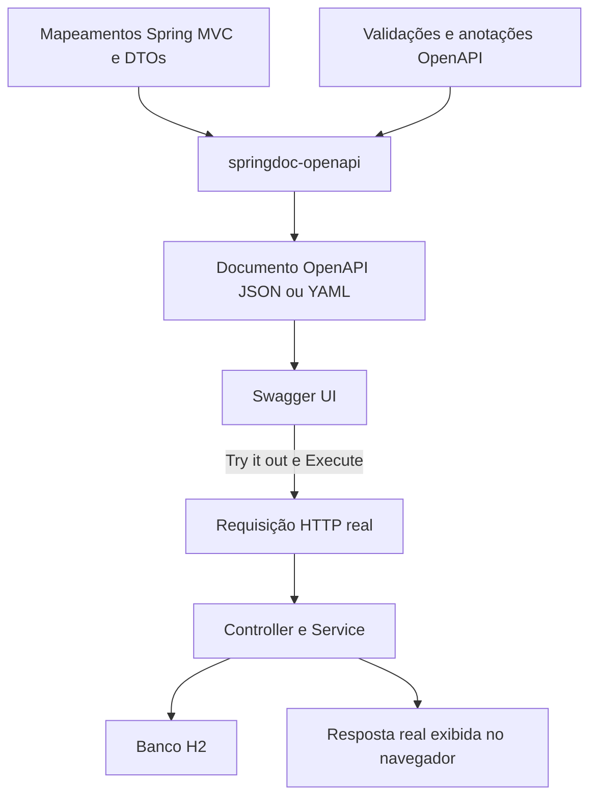

# Tutorial 4 — OpenAPI e Swagger UI

## Missão e resultado esperado

Depois de integrar [requisições, camadas e validação](03-camadas-requisicoes-validacao.md), publique um contrato que outra equipe consiga consultar sem ler os services. Este tutorial acompanha a branch `feature/04-openapi-swagger`, criada a partir de `feature/03-resources-validation`.

Ao concluir, a API terá descrição geral, dez operações organizadas por tags, parâmetros explicados, DTOs com exemplos, respostas de sucesso e erros documentados. A Swagger UI permitirá executar o mesmo fluxo do Insomnia. As regras de negócio, rotas, persistência e validações continuam sendo as da etapa 3; aqui acrescentamos documentação e testes do contrato gerado.

Use os exemplos como referência em outros projetos, adaptando nomes, campos e respostas à implementação real. Anotações OpenAPI descrevem comportamento; elas não implementam validação, autorização nem tratamento de exceções.

## Neste tutorial

- [1. Entenda as ferramentas e o fluxo](#1-entenda-as-ferramentas-e-o-fluxo)
- [2. Prepare a branch e adicione a dependência](#2-prepare-a-branch-e-adicione-a-dependência)
- [3. Configure o documento e a interface](#3-configure-o-documento-e-a-interface)
- [4. Descreva os DTOs e o modelo de erro](#4-descreva-os-dtos-e-o-modelo-de-erro)
- [5. Documente operações, parâmetros e respostas](#5-documente-operações-parâmetros-e-respostas)
- [6. Leia o documento OpenAPI gerado](#6-leia-o-documento-openapi-gerado)
- [7. Execute o laboratório na Swagger UI](#7-execute-o-laboratório-na-swagger-ui)
- [8. Verifique o contrato por testes](#8-verifique-o-contrato-por-testes)
- [9. Reutilize em outros projetos](#9-reutilize-em-outros-projetos)
- [10. Investigue problemas comuns](#10-investigue-problemas-comuns)
- [11. Desafio e critérios de conclusão](#11-desafio-e-critérios-de-conclusão)

## 1. Entenda as ferramentas e o fluxo

| Termo | Responsabilidade | Neste projeto |
|---|---|---|
| OpenAPI | Especificação para descrever uma API HTTP | Documento JSON ou YAML com operações e modelos |
| springdoc-openapi | Integra Spring e geração do documento | Lê mapeamentos, tipos, validações e anotações |
| Swagger UI | Interface que apresenta o documento e envia requisições | Página interativa aberta no navegador |
| Swagger annotations | Metadados adicionais no Java | Imports `io.swagger.v3.oas.annotations.*` |
| Bean Validation | Verifica os dados recebidos em execução | `@NotBlank`, `@Size`, `@NotEmpty` e `@Valid` |

Adotamos **code-first**: o contrato é gerado a partir da aplicação. No fluxo design-first, uma equipe escreve o contrato antes e implementa a API a partir dele. Em ambos, o documento deve corresponder às respostas reais.



**Try it out não simula operações.** POST cria registros, PUT modifica dados e DELETE arquiva propostas ou remove curtidas. Use os dados demonstrativos locais para o laboratório.

## 2. Prepare a branch e adicione a dependência

Pré-requisitos: tutorial 3 concluído, JDK 17 disponível, Gradle Wrapper do repositório, acesso às dependências e porta 8080 livre. Não é necessário instalar Swagger separadamente.

Confira o trabalho local com `git status`. Se for iniciar a implementação a partir da etapa anterior e a nova branch ainda não existir, use os comandos abaixo, iguais no PowerShell e no Bash:

```bash
git switch feature/03-resources-validation
git switch -c feature/04-openapi-swagger
```

Se a branch já existir no seu clone, apenas execute `git switch feature/04-openapi-swagger`. Não descarte alterações locais para trocar de etapa.

Este projeto usa Spring Boot **4.1.1**, Java **17** e springdoc **3.1.1**. O starter escolhido integra Spring MVC e inclui a interface. A linha springdoc 3.x corresponde ao Spring Boot 4; ao reutilizar em outra versão, consulte a [matriz oficial de compatibilidade](https://springdoc.org/faq.html). A dependência abaixo segue o [guia oficial de instalação](https://springdoc.org/getting-started.html).

Dentro de `dependencies` em `build.gradle`, acrescente uma única vez:

```gradle
implementation 'org.springdoc:springdoc-openapi-starter-webmvc-ui:3.1.1'
```

Mantenha os starters Web MVC e Validation existentes. A versão do springdoc está explícita porque não devemos presumir que o gerenciamento de dependências do Spring Boot a escolha. Para um projeto WebFlux, selecione o starter correspondente àquela stack; não misture os starters MVC e WebFlux apenas para obter documentação.

No Linux/macOS:

```bash
./gradlew test
./gradlew bootRun
```

No Windows PowerShell:

```powershell
.\gradlew.bat test
.\gradlew.bat bootRun
```

Mantenha o terminal do `bootRun` aberto. Use outro terminal para requisições e `Ctrl+C` para encerrar a aplicação. Depois de alterar dependências ou anotações, reinicie para conferir o documento atualizado.

## 3. Configure o documento e a interface

### 3.1. Metadados gerais

Crie a configuração abaixo dentro do pacote base da aplicação, para que o Spring encontre `@Configuration`. `@Bean` registra o objeto que o springdoc usará como base do documento.

Arquivo `src/main/java/br/com/fatecararas/piapi/infrastructure/config/OpenApiConfig.java`:

```java
package br.com.fatecararas.piapi.infrastructure.config;

import io.swagger.v3.oas.models.OpenAPI;
import io.swagger.v3.oas.models.info.Info;
import org.springframework.context.annotation.Bean;
import org.springframework.context.annotation.Configuration;

@Configuration
public class OpenApiConfig {

    @Bean
    public OpenAPI propostasOpenAPI() {
        return new OpenAPI().info(new Info()
                .title("API de propostas interdisciplinares")
                .version("1.0.0")
                .description("API didática da Fatec Antonio Brambilla. "
                        + "Listagens públicas contêm somente propostas publicadas, com até 10 itens por página. "
                        + "Nesta etapa não há autenticação: autor e curtidas usam o usuário demonstrativo. "
                        + "Os dados do H2 em memória são apagados ao encerrar a aplicação."));
    }
}
```

`Info.version` identifica a versão informativa do contrato da API. Ela não é a versão do Spring Boot, do springdoc nem o campo `openapi` do documento. Não altera as rotas para `/v1`. Atualize esse valor conforme a política de versão do seu projeto.

Não fixamos `servers` com `localhost`: o springdoc pode derivar a URL da requisição. Atrás de proxy, domínio ou caminho externo, configure a aplicação e os cabeçalhos encaminhados de acordo com a infraestrutura. Não corrija uma URL de produção apenas mudando os exemplos.

### 3.2. Propriedades

Acrescente o bloco `springdoc` no nível raiz de `application.yaml`, como irmão de `spring`, preservando o restante da configuração:

```yaml
springdoc:
  paths-to-match: /api/**
  override-with-generic-response: false
  default-produces-media-type: application/json
  swagger-ui:
    tags-sorter: alpha
    operations-sorter: method
```

| Propriedade | Motivo |
|---|---|
| `paths-to-match` | Documenta as rotas da aplicação sob `/api`, sem incluir `/error` |
| `override-with-generic-response: false` | Evita adicionar automaticamente respostas do advice a toda operação, como `404` nos catálogos |
| `default-produces-media-type` | Usa JSON como tipo padrão no documento para retornos cuja mídia não foi explicitada |
| `tags-sorter` | Ordena os grupos alfabeticamente na interface |
| `operations-sorter` | Organiza as operações por método HTTP |

Essas opções alteram documentação/apresentação. `paths-to-match` não bloqueia rotas; `default-produces-media-type` não muda a negociação HTTP dos controllers. Ao desativar respostas genéricas do advice, descrevemos os erros aplicáveis em cada endpoint. Consulte as [propriedades oficiais do springdoc](https://springdoc.org/properties.html).

### 3.3. Endereços para conferir

| Endereço local | Resultado |
|---|---|
| `http://localhost:8080/swagger-ui/index.html` | Interface interativa |
| `http://localhost:8080/swagger-ui.html` | Entrada que redireciona para a interface |
| `http://localhost:8080/v3/api-docs` | Contrato em JSON |
| `http://localhost:8080/v3/api-docs.yaml` | Contrato em YAML |
| `http://localhost:8080/v3/api-docs/swagger-config` | Configuração usada pela interface para localizar o contrato |

Se mudar a porta ou configurar `server.servlet.context-path`, ajuste todos os endereços. Não adicione o prefixo `/api` a `/v3/api-docs`: ele pertence às rotas dos controllers, não ao documento.

## 4. Descreva os DTOs e o modelo de erro

### 4.1. Entrada: descrição complementa validação

`@Schema` explica o significado e fornece exemplos. `@NotBlank` e `@Size` continuam responsáveis pelas restrições verificadas pelo MVC com `@Valid`. O springdoc aproveita constraints suportadas para gerar propriedades como campos obrigatórios, `minLength` e `maxLength`; os testes abaixo conferem esse resultado.

Um exemplo não é um valor padrão: `example = "1"` não preenche um campo omitido em uma requisição. Os IDs dos exemplos são válidos para a carga V2 deste projeto; outros projetos precisam de seus próprios exemplos.

Arquivo `src/main/java/br/com/fatecararas/piapi/application/dto/CriarPropostaRequest.java`:

```java
package br.com.fatecararas.piapi.application.dto;

import io.swagger.v3.oas.annotations.media.Schema;
import jakarta.validation.constraints.NotBlank;
import jakarta.validation.constraints.NotEmpty;
import jakarta.validation.constraints.NotNull;
import jakarta.validation.constraints.Size;

import java.util.List;

// DTO de entrada: recebe apenas os campos que o cliente pode informar.
// As constraints são de Jakarta Validation e são verificadas pelo MVC com @Valid.
@Schema(description = "Campos editáveis da proposta. Todos são obrigatórios; IDs devem existir em catálogos ativos.")
public record CriarPropostaRequest(
        @Schema(description = "Título apresentado na listagem.", example = "Horta comunitária conectada")
        @NotBlank @Size(min = 5, max = 120) String titulo,
        @Schema(description = "Resumo para cartões e resultados.", example = "Monitoramento acessível de uma horta local.")
        @NotBlank @Size(max = 300) String resumo,
        @Schema(description = "Descrição detalhada da proposta.", example = "Integração de tecnologia e sustentabilidade na comunidade.")
        @NotBlank @Size(max = 10_000) String descricao,
        // A lista precisa ter itens; cada ID deve ser não nulo. Existência é regra do service.
        @Schema(description = "IDs de públicos-alvo ativos; repetições representam uma única associação.", example = "[1]")
        @NotEmpty List<@NotNull Long> publicoAlvoIds,
        @Schema(description = "ID de uma categoria ativa.", example = "1")
        @NotNull Long categoriaId,
        @Schema(description = "IDs de cursos ativos; repetições representam uma única associação.", example = "[1, 2]")
        @NotEmpty List<@NotNull Long> cursoIds) {
}
```

A atualização também exige todos os campos editáveis. Use um record próprio para que criação e atualização possam evoluir independentemente:

Arquivo `src/main/java/br/com/fatecararas/piapi/application/dto/AtualizarPropostaRequest.java`:

```java
package br.com.fatecararas.piapi.application.dto;

import io.swagger.v3.oas.annotations.media.Schema;
import jakarta.validation.constraints.NotBlank;
import jakarta.validation.constraints.NotEmpty;
import jakarta.validation.constraints.NotNull;
import jakarta.validation.constraints.Size;

import java.util.List;

// DTO de entrada: recebe apenas os campos que o cliente pode informar.
// As constraints são de Jakarta Validation e são verificadas pelo MVC com @Valid.
@Schema(description = "Campos editáveis da proposta. Todos são obrigatórios; IDs devem existir em catálogos ativos.")
public record AtualizarPropostaRequest(
        @Schema(description = "Título apresentado na listagem.", example = "Horta comunitária conectada")
        @NotBlank @Size(min = 5, max = 120) String titulo,
        @Schema(description = "Resumo para cartões e resultados.", example = "Monitoramento acessível de uma horta local.")
        @NotBlank @Size(max = 300) String resumo,
        @Schema(description = "Descrição detalhada da proposta.", example = "Integração de tecnologia e sustentabilidade na comunidade.")
        @NotBlank @Size(max = 10_000) String descricao,
        // A lista precisa ter itens; cada ID deve ser não nulo. Existência é regra do service.
        @Schema(description = "IDs de públicos-alvo ativos; repetições representam uma única associação.", example = "[1]")
        @NotEmpty List<@NotNull Long> publicoAlvoIds,
        @Schema(description = "ID de uma categoria ativa.", example = "1")
        @NotNull Long categoriaId,
        @Schema(description = "IDs de cursos ativos; repetições representam uma única associação.", example = "[1, 2]")
        @NotEmpty List<@NotNull Long> cursoIds) {
}
```

Não adicione `autorId`, `status` ou datas ao request para fazê-los aparecer na documentação. Esses valores pertencem ao servidor. DTOs separados de entrada e saída tornam esse limite explícito.

### 4.2. Saída e paginação genérica

Arquivo `src/main/java/br/com/fatecararas/piapi/application/dto/PropostaResponse.java`:

```java
package br.com.fatecararas.piapi.application.dto;

import br.com.fatecararas.piapi.domain.model.StatusProposta;
import io.swagger.v3.oas.annotations.media.Schema;

import java.time.Instant;
import java.util.List;

// DTO de saída: expõe os dados da proposta sem serializar as entidades JPA.
@Schema(description = "Proposta devolvida pela API; não expõe entidades nem senha do autor.")
public record PropostaResponse(
        @Schema(description = "Identificador gerado pelo servidor.", example = "1")
        Long id,
        @Schema(description = "Título da proposta.", example = "Horta comunitária conectada")
        String titulo,
        @Schema(description = "Resumo da proposta.", example = "Monitoramento acessível de uma horta local.")
        String resumo,
        @Schema(description = "Descrição detalhada.", example = "Integração de tecnologia e sustentabilidade na comunidade.")
        String descricao,
        @Schema(description = "IDs dos públicos associados.", example = "[1]")
        List<Long> publicoAlvoIds,
        @Schema(description = "ID da categoria.", example = "1")
        Long categoriaId,
        @Schema(description = "IDs dos cursos associados.", example = "[1, 2]")
        List<Long> cursoIds,
        @Schema(description = "Autor definido pelo backend; demonstrativo nesta etapa.", example = "1")
        Long autorId,
        @Schema(description = "Nome público do autor.", example = "Usuário de demonstração")
        String autorNome,
        @Schema(description = "Situação da proposta; consultas públicas retornam PUBLICADA.", example = "PUBLICADA")
        StatusProposta status,
        @Schema(description = "Total de curtidas persistidas.", example = "0")
        int quantidadeCurtidas,
        @Schema(description = "Indica curtida do usuário demonstrativo enquanto não há login.", example = "false")
        boolean curtidaPeloUsuarioAtual,
        @Schema(description = "Instante de criação em UTC.", example = "2026-10-24T12:00:00Z")
        Instant criadaEm,
        @Schema(description = "Instante da última alteração em UTC.", example = "2026-10-24T12:00:00Z")
        Instant atualizadaEm) {
}
```

Arquivo `src/main/java/br/com/fatecararas/piapi/application/dto/PaginaResponse.java`:

```java
package br.com.fatecararas.piapi.application.dto;

import io.swagger.v3.oas.annotations.media.Schema;
import java.util.List;

@Schema(description = "Página de resultados. Uma página vazia também retorna HTTP 200.")
public record PaginaResponse<T>(
        @Schema(description = "Itens desta página; no máximo 10.") List<T> conteudo,
        @Schema(description = "Índice da página, começando em zero.", example = "0") int pagina,
        @Schema(description = "Capacidade fixa da página, não a quantidade retornada.", example = "10") int tamanho,
        @Schema(description = "Total de propostas que atendem aos filtros.", example = "1") long totalElementos,
        @Schema(description = "Total de páginas disponíveis.", example = "1") int totalPaginas) {
}
```

O retorno Java `PaginaResponse<PropostaResponse>` permite ao springdoc descrever os itens de `conteudo` como propostas. Evite substituí-lo na documentação por apenas `@Schema(implementation = PaginaResponse.class)`: a classe sem o parâmetro genérico pode perder a informação do tipo dos itens.

Nos sucessos `200`, deixamos o schema ser inferido do retorno declarado. Na criação, explicitamos `PropostaResponse` junto do `201` e do cabeçalho `Location`. O campo `tamanho` vale 10 mesmo quando `conteudo` tem menos itens; uma página vazia é sucesso, não recurso inexistente.

Arquivo `src/main/java/br/com/fatecararas/piapi/application/dto/ItemCatalogoResponse.java`:

```java
package br.com.fatecararas.piapi.application.dto;

import io.swagger.v3.oas.annotations.media.Schema;

@Schema(description = "Item ativo de catálogo. Descrição e sigla podem ser nulas conforme o catálogo.")
public record ItemCatalogoResponse(
        @Schema(description = "ID usado nos filtros e no corpo da proposta.", example = "1") Long id,
        @Schema(description = "Nome do item.", example = "Tecnologia e inovação") String nome,
        @Schema(description = "Descrição, quando disponível.", example = "Soluções digitais e novos produtos.") String descricao,
        @Schema(description = "Sigla apenas para cursos, quando informada.", example = "DSM") String sigla) {
}
```

`ItemCatalogoResponse` é compartilhado pelos três catálogos. O exemplo de nome é ilustrativo; categoria não tem sigla, curso pode ter sigla e os campos sem uso podem ser nulos. Exemplos não garantem que todos os campos estejam preenchidos em toda resposta.

### 4.3. Erros: documente apenas o formato garantido

O advice continua com a mesma lógica do tutorial 3. Adicione o import `io.swagger.v3.oas.annotations.media.Schema` e substitua somente a declaração do record interno pelo trecho abaixo:

```java
@Schema(description = "Erro tratado pelo advice. Falhas de conversão em query/path não seguem este modelo.")
    public record ErroResponse(
            @Schema(description = "Instante do erro em UTC.") Instant instante,
            @Schema(description = "Código HTTP.", example = "400") int status,
            @Schema(description = "Categoria do erro.", example = "Dados inválidos") String erro,
            @Schema(description = "Orientação para o consumidor.", example = "Revise os campos informados.") String mensagem,
            @Schema(description = "Uma mensagem por campo inválido; vazio para erros de regra ou JSON.")
            Map<String, String> campos) {
    }
```

O arquivo completo permanece em `src/main/java/br/com/fatecararas/piapi/infrastructure/web/rest/exception/ApiExceptionHandler.java`.

| Caso | Status | Formato garantido |
|---|---|---|
| DTO inválido | `400` | `ErroResponse`, com `campos` preenchido |
| JSON ilegível ou tipo incompatível no corpo | `400` | `ErroResponse`, com `campos` vazio |
| Catálogo inexistente/inativo | `400` | `ErroResponse`, com mensagem da regra |
| Proposta indisponível | `404` | `ErroResponse` |
| `page=abc`, `status=INVALIDO` ou ID não numérico no caminho | `400` | Tratamento padrão do Spring; este advice não garante o corpo |

Por isso, o POST documenta `400` com `ErroResponse`; operações com query/path usam uma descrição mais ampla e schema `object` para `400`. Não prometemos que toda falha tenha o mesmo modelo. Os exemplos de mensagens de validação são ilustrativos: idioma e mensagem escolhida por campo podem variar.

## 5. Documente operações, parâmetros e respostas

### 5.1. Guia das anotações

| Anotação | Onde usar | Função |
|---|---|---|
| `@Tag` | Controller | Agrupar operações por assunto |
| `@Operation` | Método | Resumo, descrição e `operationId` |
| `@Parameter` | Parâmetro | Explicar query/path e fornecer exemplo |
| `@ApiResponse` | Método | Associar código HTTP, descrição, cabeçalhos e conteúdo |
| `@Content` | Dentro da resposta | Descrever mídia, schema e exemplos; vazio indica ausência de corpo |
| `@Schema` | Tipo/campo ou conteúdo | Descrever o modelo de dados |
| `@Header` | Dentro da resposta | Documentar cabeçalhos, como `Location` |
| `@ExampleObject` | Dentro de `@Content` | Fornecer exemplos nomeados de corpo |

`operationId` deve ser único e estável: consumidores e geradores de clientes podem usá-lo para nomear métodos. Um `summary` deve permitir identificar a ação sem ler um parágrafo; use `description` para regras e limites.

**Cuidado com dois `RequestBody`:** `org.springframework.web.bind.annotation.RequestBody` faz o binding do JSON em execução; `io.swagger.v3.oas.annotations.parameters.RequestBody` apenas documenta o corpo. Neste projeto, o tipo Java e a anotação Spring já fornecem a entrada. Caso precise da anotação OpenAPI para exemplos específicos da operação, use o nome completo para evitar conflito de imports. Nunca substitua a anotação Spring pela de documentação.

### 5.2. Controller de propostas completo

Compare cada anotação com o retorno do método. `@ApiResponse(responseCode = "201")` não faz o servidor responder `201`: isso vem de `ResponseEntity.created(...)`. O mesmo vale para `204`, definido por `noContent()`.

Arquivo `src/main/java/br/com/fatecararas/piapi/infrastructure/web/rest/controller/PropostasResource.java`:

```java
package br.com.fatecararas.piapi.infrastructure.web.rest.controller;

import br.com.fatecararas.piapi.application.dto.AtualizarPropostaRequest;
import br.com.fatecararas.piapi.application.dto.CriarPropostaRequest;
import br.com.fatecararas.piapi.application.dto.PaginaResponse;
import br.com.fatecararas.piapi.application.dto.PropostaResponse;
import br.com.fatecararas.piapi.application.service.PropostaService;
import br.com.fatecararas.piapi.domain.model.StatusProposta;
import br.com.fatecararas.piapi.infrastructure.web.rest.exception.ApiExceptionHandler.ErroResponse;
import io.swagger.v3.oas.annotations.Operation;
import io.swagger.v3.oas.annotations.Parameter;
import io.swagger.v3.oas.annotations.headers.Header;
import io.swagger.v3.oas.annotations.media.Content;
import io.swagger.v3.oas.annotations.media.ExampleObject;
import io.swagger.v3.oas.annotations.media.Schema;
import io.swagger.v3.oas.annotations.responses.ApiResponse;
import io.swagger.v3.oas.annotations.tags.Tag;
import jakarta.validation.Valid;
import lombok.RequiredArgsConstructor;
import org.springframework.http.ResponseEntity;
import org.springframework.web.bind.annotation.DeleteMapping;
import org.springframework.web.bind.annotation.GetMapping;
import org.springframework.web.bind.annotation.PathVariable;
import org.springframework.web.bind.annotation.PostMapping;
import org.springframework.web.bind.annotation.PutMapping;
import org.springframework.web.bind.annotation.RequestBody;
import org.springframework.web.bind.annotation.RequestMapping;
import org.springframework.web.bind.annotation.RequestParam;
import org.springframework.web.bind.annotation.RestController;
import org.springframework.web.servlet.support.ServletUriComponentsBuilder;

import java.net.URI;

// Lombok gera o construtor para injetar o service declarado como final.
@RequiredArgsConstructor
// Resource é o nome adotado para o controller REST: recebe HTTP e delega ao service.
@RestController
// Prefixo compartilhado pelas rotas desta classe.
@Tag(name = "Propostas", description = "Publicação, consulta, atualização, arquivamento e curtidas.")
@RequestMapping("/api/propostas")
public class PropostasResource {

    private final PropostaService propostaService;

    // @RequestParam lê filtros da URL; page começa em zero quando não informado.
    @Operation(operationId = "listarPropostas", summary = "Listar propostas publicadas",
            description = "Até 10 itens por página, ordenados por criação decrescente. Filtros combinados com AND; "
                    + "q busca título, resumo ou descrição. status=ARQUIVADA retorna uma página vazia.")
    @ApiResponse(responseCode = "200", description = "Página encontrada, inclusive quando vazia.")
    @ApiResponse(responseCode = "400", description = "Entrada inválida. Erros tratados usam ErroResponse; "
            + "falhas de conversão em query/path usam o corpo padrão do Spring, sem formato garantido.",
            content = @Content(mediaType = "application/json", schema = @Schema(type = "object")))
    @GetMapping
    public ResponseEntity<PaginaResponse<PropostaResponse>> listar(
            @Parameter(description = "Texto procurado em título, resumo ou descrição.", example = "horta")
            @RequestParam(required = false) String q,
            @Parameter(description = "ID da categoria usada como filtro.", example = "1")
            @RequestParam(required = false) Long categoriaId,
            @Parameter(description = "ID do público-alvo usado como filtro.", example = "1")
            @RequestParam(required = false) Long publicoAlvoId,
            @Parameter(description = "ID do curso usado como filtro.", example = "1")
            @RequestParam(required = false) Long cursoId,
            @Parameter(description = "A consulta é pública: ARQUIVADA produz página vazia.", example = "PUBLICADA")
            @RequestParam(required = false) StatusProposta status,
            @Parameter(description = "Página começando em zero; tamanho fixo de 10.", schema = @Schema(minimum = "0"))
            @RequestParam(defaultValue = "0") int page) {
        return ResponseEntity.ok(propostaService.listar(q, categoriaId, publicoAlvoId, cursoId, status, page));
    }

    // @PathVariable obtém o identificador que faz parte do caminho.
    @Operation(operationId = "buscarProposta", summary = "Consultar uma proposta publicada")
    @ApiResponse(responseCode = "200", description = "Proposta encontrada.")
    @ApiResponse(responseCode = "404", description = "Proposta não encontrada ou indisponível.",
            content = @Content(mediaType = "application/json", schema = @Schema(implementation = ErroResponse.class)))
    @ApiResponse(responseCode = "400", description = "Entrada inválida. Erros tratados usam ErroResponse; "
            + "falhas de conversão em query/path usam o corpo padrão do Spring, sem formato garantido.",
            content = @Content(mediaType = "application/json", schema = @Schema(type = "object")))
    @GetMapping("/{id}")
    public ResponseEntity<PropostaResponse> buscarPorId(@Parameter(description = "ID da proposta.", example = "1") @PathVariable Long id) {
        return ResponseEntity.ok(propostaService.buscarPorId(id));
    }

    // @RequestBody converte JSON em DTO; @Valid verifica suas constraints antes do método.
    @Operation(operationId = "criarProposta", summary = "Publicar uma proposta",
            description = "Recebe somente campos editáveis. Autor, status PUBLICADA, ID e datas são definidos pelo servidor.")
    @ApiResponse(responseCode = "201", description = "Proposta criada.",
            headers = @Header(name = "Location", description = "Endereço do detalhe da proposta criada.",
                    schema = @Schema(type = "string", format = "uri", example = "http://localhost:8080/api/propostas/1")),
            content = @Content(mediaType = "application/json", schema = @Schema(implementation = PropostaResponse.class)))
    @ApiResponse(responseCode = "400", description = "DTO inválido, JSON ilegível ou catálogo inexistente/inativo.",
            content = @Content(mediaType = "application/json", schema = @Schema(implementation = ErroResponse.class),
                    examples = {
                            @ExampleObject(name = "Validacao", summary = "Exemplo ilustrativo de campo inválido",
                                    value = "{\"instante\":\"2026-10-24T12:00:00Z\",\"status\":400,\"erro\":\"Dados inválidos\","
                                            + "\"mensagem\":\"Revise os campos informados.\",\"campos\":{\"titulo\":\"não deve estar em branco\"}}"),
                            @ExampleObject(name = "Regra", summary = "Categoria inexistente ou inativa",
                                    value = "{\"instante\":\"2026-10-24T12:00:00Z\",\"status\":400,\"erro\":\"Requisição inválida\","
                                            + "\"mensagem\":\"Categoria não existe ou está inativa.\",\"campos\":{}}")
                    }))
    @PostMapping
    public ResponseEntity<PropostaResponse> criar(@Valid @RequestBody CriarPropostaRequest request) {
        PropostaResponse criada = propostaService.criar(request);
        // 201 Created devolve a representação e o endereço do recurso no cabeçalho Location.
        URI location = ServletUriComponentsBuilder.fromCurrentRequest().path("/{id}")
                .buildAndExpand(criada.id()).toUri();
        return ResponseEntity.created(location).body(criada);
    }

    // Atualiza todos os campos editáveis; não é uma atualização parcial (PATCH).
    @Operation(operationId = "atualizarProposta", summary = "Atualizar os campos editáveis",
            description = "PUT exige todos os campos do DTO. Não permite trocar autor, ID, status ou datas.")
    @ApiResponse(responseCode = "200", description = "Proposta atualizada.")
    @ApiResponse(responseCode = "404", description = "Proposta não encontrada ou indisponível.",
            content = @Content(mediaType = "application/json", schema = @Schema(implementation = ErroResponse.class)))
    @ApiResponse(responseCode = "400", description = "Entrada inválida. Erros tratados usam ErroResponse; "
            + "falhas de conversão em query/path usam o corpo padrão do Spring, sem formato garantido.",
            content = @Content(mediaType = "application/json", schema = @Schema(type = "object")))
    @PutMapping("/{id}")
    public ResponseEntity<PropostaResponse> atualizar(@Parameter(description = "ID da proposta.", example = "1") @PathVariable Long id,
                                                       @Valid @RequestBody AtualizarPropostaRequest request) {
        return ResponseEntity.ok(propostaService.atualizar(id, request));
    }

    // O service arquiva a proposta; 204 indica sucesso sem corpo na resposta.
    @Operation(operationId = "arquivarProposta", summary = "Arquivar uma proposta",
            description = "Exclusão lógica: preserva a linha e as curtidas. Repetir para um ID existente mantém 204.")
    @ApiResponse(responseCode = "204", description = "Proposta arquivada; sem corpo.", content = @Content)
    @ApiResponse(responseCode = "404", description = "Não existe proposta com esse ID.",
            content = @Content(mediaType = "application/json", schema = @Schema(implementation = ErroResponse.class)))
    @ApiResponse(responseCode = "400", description = "Entrada inválida. Erros tratados usam ErroResponse; "
            + "falhas de conversão em query/path usam o corpo padrão do Spring, sem formato garantido.",
            content = @Content(mediaType = "application/json", schema = @Schema(type = "object")))
    @DeleteMapping("/{id}")
    public ResponseEntity<Void> arquivar(@Parameter(description = "ID da proposta.", example = "1") @PathVariable Long id) {
        propostaService.arquivar(id);
        return ResponseEntity.noContent().build();
    }

    @Operation(operationId = "curtirProposta", summary = "Curtir uma proposta publicada",
            description = "Usa o usuário demonstrativo. Repetições sequenciais não aumentam o contador.")
    @ApiResponse(responseCode = "200", description = "Proposta com a situação da curtida atualizada.")
    @ApiResponse(responseCode = "404", description = "Proposta não encontrada ou indisponível.",
            content = @Content(mediaType = "application/json", schema = @Schema(implementation = ErroResponse.class)))
    @ApiResponse(responseCode = "400", description = "Entrada inválida. Erros tratados usam ErroResponse; "
            + "falhas de conversão em query/path usam o corpo padrão do Spring, sem formato garantido.",
            content = @Content(mediaType = "application/json", schema = @Schema(type = "object")))
    @PutMapping("/{id}/curtida")
    public ResponseEntity<PropostaResponse> curtir(@Parameter(description = "ID da proposta.", example = "1") @PathVariable Long id) {
        return ResponseEntity.ok(propostaService.curtir(id));
    }

    @Operation(operationId = "removerCurtida", summary = "Remover a curtida",
            description = "Remove a curtida do usuário demonstrativo; devolve a proposta, mesmo se não havia curtida.")
    @ApiResponse(responseCode = "200", description = "Proposta com a situação da curtida atualizada.")
    @ApiResponse(responseCode = "404", description = "Proposta não encontrada ou indisponível.",
            content = @Content(mediaType = "application/json", schema = @Schema(implementation = ErroResponse.class)))
    @ApiResponse(responseCode = "400", description = "Entrada inválida. Erros tratados usam ErroResponse; "
            + "falhas de conversão em query/path usam o corpo padrão do Spring, sem formato garantido.",
            content = @Content(mediaType = "application/json", schema = @Schema(type = "object")))
    @DeleteMapping("/{id}/curtida")
    public ResponseEntity<PropostaResponse> removerCurtida(@Parameter(description = "ID da proposta.", example = "1") @PathVariable Long id) {
        return ResponseEntity.ok(propostaService.removerCurtida(id));
    }
}
```

Observe três escolhas importantes para reproduzir em seus projetos:

- **Criação:** `201` tem schema e cabeçalho `Location`; não é documentado como um `200` genérico.
- **Arquivamento:** `204` usa `content = @Content`, sem schema de resposta. Não invente um JSON vazio para uma resposta sem corpo.
- **Remoção de curtida:** `DELETE` responde `200` com proposta atualizada. O verbo sozinho não determina o status.

Os exemplos de erro usam constantes de texto nas anotações; `@ExampleObject` não gera erros reais nem muda o handler. Nos DTOs, os exemplos de campo ajudam a Swagger UI a montar um corpo de entrada.

### 5.3. Catálogos completos

Arquivo `src/main/java/br/com/fatecararas/piapi/infrastructure/web/rest/controller/CatalogosResource.java`:

```java
package br.com.fatecararas.piapi.infrastructure.web.rest.controller;

import br.com.fatecararas.piapi.application.dto.ItemCatalogoResponse;
import br.com.fatecararas.piapi.application.service.CatalogoService;
import io.swagger.v3.oas.annotations.Operation;
import io.swagger.v3.oas.annotations.responses.ApiResponse;
import io.swagger.v3.oas.annotations.tags.Tag;
import org.springframework.http.ResponseEntity;
import org.springframework.web.bind.annotation.GetMapping;
import org.springframework.web.bind.annotation.RequestMapping;
import org.springframework.web.bind.annotation.RestController;

import java.util.List;

// Resource é o nome adotado para o controller REST: recebe HTTP e delega ao service.
@RestController
// Prefixo compartilhado pelas rotas desta classe.
@Tag(name = "Catálogos", description = "Itens ativos para preencher formulários e filtros.")
@RequestMapping("/api")
public class CatalogosResource {

    private final CatalogoService catalogoService;

    // Com um único construtor, o Spring injeta a dependência sem precisar de @Autowired.
    public CatalogosResource(CatalogoService catalogoService) {
        this.catalogoService = catalogoService;
    }

    @Operation(operationId = "listarCategorias", summary = "Listar categorias ativas", description = "Itens ordenados pelo nome; use os IDs no corpo da proposta.")
    @ApiResponse(responseCode = "200", description = "Lista de itens ativos, possivelmente vazia.")
    @GetMapping("/categorias")
    public ResponseEntity<List<ItemCatalogoResponse>> listarCategorias() {
        return ResponseEntity.ok(catalogoService.listarCategorias());
    }

    @Operation(operationId = "listarCursos", summary = "Listar cursos ativos", description = "Itens ordenados pelo nome; use os IDs no corpo da proposta.")
    @ApiResponse(responseCode = "200", description = "Lista de itens ativos, possivelmente vazia.")
    @GetMapping("/cursos")
    public ResponseEntity<List<ItemCatalogoResponse>> listarCursosAtivos() {
        return ResponseEntity.ok(catalogoService.listarCursos());
    }

    @Operation(operationId = "listarPublicosAlvo", summary = "Listar públicos-alvo ativos", description = "Itens ordenados pelo nome; use os IDs no corpo da proposta.")
    @ApiResponse(responseCode = "200", description = "Lista de itens ativos, possivelmente vazia.")
    @GetMapping("/publicos-alvo")
    public ResponseEntity<List<ItemCatalogoResponse>> listarPublicosAlvoAtivos() {
        return ResponseEntity.ok(catalogoService.listarPublicosAlvo());
    }
}
```

Uma lista sem itens retorna `200` e `[]`. Não adicionamos `404` a essas operações, pois elas não procuram um item por ID. A configuração que desativa respostas genéricas evita que o advice acrescente esse erro indevidamente.

## 6. Leia o documento OpenAPI gerado

Abra `/v3/api-docs` e localize:

| Campo | O que conferir |
|---|---|
| `openapi` | Versão da especificação emitida pela biblioteca |
| `info` | Título, descrição e versão definidos no bean |
| `paths` | Seis caminhos contendo dez operações HTTP |
| `parameters` | Query/path, obrigatoriedade, exemplos e schema |
| `requestBody` | Corpo JSON e referência ao DTO de entrada |
| `responses` | Status, conteúdo e cabeçalhos por operação |
| `components.schemas` | Modelos reutilizáveis de entrada, saída e erro |
| `$ref` | Referência a uma definição do mesmo documento |

Um `$ref` como `#/components/schemas/CriarPropostaRequest` aponta para o schema correspondente. Não é uma URL de endpoint. O nome gerado para uma página genérica pode depender da biblioteca; confira o tipo de `conteudo` em vez de presumir o nome do schema.

Recorte ilustrativo do contrato de arquivamento:

```yaml
paths:
  /api/propostas/{id}:
    delete:
      operationId: arquivarProposta
      responses:
        '204':
          description: Proposta arquivada; sem corpo.
```

Note a ausência de `content` em `204`. Esse recorte não é um documento completo e não precisa ser salvo em `src/main/resources`: a aplicação gera o contrato.

Para exportar uma cópia temporária no Linux/macOS:

```bash
curl --fail http://localhost:8080/v3/api-docs -o /tmp/piapi-openapi.json
curl --fail http://localhost:8080/v3/api-docs.yaml -o /tmp/piapi-openapi.yaml
```

No Windows PowerShell:

```powershell
curl.exe --fail http://localhost:8080/v3/api-docs -o "$env:TEMP/piapi-openapi.json"
curl.exe --fail http://localhost:8080/v3/api-docs.yaml -o "$env:TEMP/piapi-openapi.yaml"
```

Use `curl.exe` para evitar o alias do Windows PowerShell. A cópia exportada representa aquele momento; ela não se atualiza ao alterar o Java. Não mantenha duas fontes de verdade sem uma rotina de geração e conferência.

## 7. Execute o laboratório na Swagger UI

Inicie com o H2 em memória. A migration fornece catálogos e usuário demonstrativo, mas nenhuma proposta. Abra `http://localhost:8080/swagger-ui/index.html`; os grupos esperados são **Catálogos** e **Propostas**. A seção **Schemas** apresenta os DTOs.

### 7.1. Sucesso de ponta a ponta

1. Expanda `GET /api/categorias`, clique em **Try it out** e depois **Execute**. Confira `200` e IDs; repita para cursos e públicos-alvo.
2. Expanda `POST /api/propostas`. Leia a descrição, o modelo de entrada e o `201` documentado antes de executar.
3. Clique em **Try it out**, confirme o corpo abaixo e execute.

```json
{
  "titulo": "Horta comunitária conectada",
  "resumo": "Monitoramento acessível de uma horta local.",
  "descricao": "Integração de tecnologia e sustentabilidade na comunidade.",
  "publicoAlvoIds": [1],
  "categoriaId": 1,
  "cursoIds": [1, 2]
}
```

4. Na resposta real, copie `id` e confira `Location`. O exemplo `id: 1` exibido no schema não garante qual ID será gerado.
5. Execute o detalhe com esse ID e a listagem com `page=0`. Use `q=horta` e, depois, combine um filtro de curso. `tamanho` vale 10; `conteudo` deve refletir os resultados disponíveis.
6. Atualize por PUT, enviando todos os campos editáveis com um título diferente. Confira o `200` e a nova representação.
7. Execute PUT de curtida duas vezes. O contador deve chegar a 1 e permanecer 1. DELETE de curtida retorna `200` e contador 0.
8. Arquive por DELETE da proposta. Confira `204` sem corpo. O GET do mesmo ID deve retornar `404`; a listagem pública não deve incluir essa proposta.

Na interface, **Example Value** mostra um exemplo de documentação; **Server response**, depois de executar, contém o resultado real. O comando cURL apresentado permite comparar a chamada com Insomnia e terminal.

### 7.2. Rejeições

| Alteração na chamada | Resultado esperado |
|---|---|
| POST com `titulo` vazio e demais campos válidos | `400` com erro no campo `titulo` |
| POST com `categoriaId: 999999` e demais campos válidos | `400` com mensagem de regra e `campos` vazio |
| POST com JSON truncado | `400` pelo handler de corpo inválido |
| GET de ID numérico inexistente | `404` com `ErroResponse` |
| GET com `page=-1` | `400` por regra do service |
| GET com `status=ARQUIVADA` | `200` e página vazia |

A Swagger UI pode validar certos campos antes de enviar, especialmente tipos e JSON. Para experimentar `page=abc` ou corpo ilegível caso a interface bloqueie o envio, use Insomnia ou os comandos do tutorial 3. A validação do navegador não substitui a do servidor.

## 8. Verifique o contrato por testes

Abrir a interface confirma disponibilidade, mas não detecta sozinho schema genérico incorreto, resposta `200` indevida no POST ou corpo indevido em `204`. O teste abaixo consulta o documento gerado e executa operações reais com MockMvc, usando um banco H2 de teste separado.

O projeto já inclui `spring-boot-starter-webmvc-test`. O import de `AutoConfigureMockMvc` abaixo corresponde ao Spring Boot 4; o parser `tools.jackson` corresponde ao Jackson 3 usado no projeto. Não copie imports de versões diferentes sem verificar suas dependências.

Arquivo `src/test/java/br/com/fatecararas/piapi/OpenApiTests.java`:

```java
package br.com.fatecararas.piapi;

import org.junit.jupiter.api.Test;
import org.springframework.beans.factory.annotation.Autowired;
import org.springframework.boot.test.context.SpringBootTest;
import org.springframework.boot.webmvc.test.autoconfigure.AutoConfigureMockMvc;
import org.springframework.http.MediaType;
import org.springframework.test.web.servlet.MockMvc;
import tools.jackson.databind.JsonNode;
import tools.jackson.databind.ObjectMapper;

import java.util.HashSet;

import static org.assertj.core.api.Assertions.assertThat;
import static org.hamcrest.Matchers.hasSize;
import static org.springframework.test.web.servlet.request.MockMvcRequestBuilders.*;
import static org.springframework.test.web.servlet.result.MockMvcResultMatchers.*;

@SpringBootTest(properties = "spring.datasource.url=jdbc:h2:mem:openapi-tests;DB_CLOSE_DELAY=-1")
@AutoConfigureMockMvc
class OpenApiTests {

    @Autowired MockMvc mvc;
    private final ObjectMapper json = new ObjectMapper();

    @Test
    void documentaOperacoesSemInventarCorpoNo204OuExporEntidades() throws Exception {
        String body = mvc.perform(get("/v3/api-docs"))
                .andExpect(status().isOk())
                .andExpect(jsonPath("$.info.title").value("API de propostas interdisciplinares"))
                .andExpect(jsonPath("$.paths['/api/propostas'].post.responses['201'].headers.Location").exists())
                .andExpect(jsonPath("$.paths['/api/propostas'].post.responses['200']").doesNotExist())
                .andExpect(jsonPath("$.paths['/api/propostas/{id}'].delete.responses['204'].content").doesNotExist())
                .andExpect(jsonPath("$.paths['/api/categorias'].get.responses['404']").doesNotExist())
                .andExpect(jsonPath("$.paths['/api/propostas'].post.responses['400'].content['application/json'].examples.Validacao").exists())
                .andExpect(jsonPath("$.components.schemas.CriarPropostaRequest.required", hasSize(6)))
                .andExpect(jsonPath("$.components.schemas.CriarPropostaRequest.properties.titulo.minLength").value(5))
                .andExpect(jsonPath("$.components.schemas.CriarPropostaRequest.properties.titulo.maxLength").value(120))
                .andReturn().getResponse().getContentAsString();
        JsonNode document = json.readTree(body);
        assertThat(document.path("paths").size()).isEqualTo(6);
        HashSet<String> operationIds = new HashSet<>();
        int operations = 0;
        for (JsonNode path : document.path("paths")) {
            for (JsonNode operation : path) {
                String id = operation.path("operationId").asText();
                assertThat(id).isNotBlank();
                assertThat(operationIds.add(id)).as("operationId único: %s", id).isTrue();
                operations++;
            }
        }
        assertThat(operations).isEqualTo(10);
        assertThat(body).doesNotContain("senhaHash", "#/components/schemas/Usuario", "\"/error\"");
        String pageRef = document.at("/paths/~1api~1propostas/get/responses/200/content/application~1json/schema/$ref").asText();
        assertThat(pageRef).startsWith("#/components/schemas/");
        JsonNode page = document.at(pageRef.substring(1));
        assertThat(page.at("/properties/conteudo/items/$ref").asText()).isEqualTo("#/components/schemas/PropostaResponse");
    }

    @Test
    void disponibilizaInterfaceConfiguracaoEYaml() throws Exception {
        mvc.perform(get("/swagger-ui/index.html"))
                .andExpect(status().isOk()).andExpect(content().contentTypeCompatibleWith(MediaType.TEXT_HTML));
        mvc.perform(get("/v3/api-docs/swagger-config"))
                .andExpect(status().isOk()).andExpect(jsonPath("$.url").value("/v3/api-docs"));
        mvc.perform(get("/v3/api-docs.yaml"))
                .andExpect(status().isOk()).andExpect(content().string(org.hamcrest.Matchers.containsString("openapi:")));
    }

    @Test
    void respostasReaisCorrespondemAosCasosDocumentados() throws Exception {
        String request = """
                {"titulo":"Horta comunitária conectada","resumo":"Monitoramento local.",
                 "descricao":"Tecnologia para a comunidade.","publicoAlvoIds":[1],"categoriaId":1,"cursoIds":[1,2]}
                """;
        String created = mvc.perform(post("/api/propostas").contentType(MediaType.APPLICATION_JSON).content(request))
                .andExpect(status().isCreated()).andExpect(header().exists("Location"))
                .andReturn().getResponse().getContentAsString();
        long id = json.readTree(created).path("id").asLong();
        mvc.perform(post("/api/propostas").contentType(MediaType.APPLICATION_JSON).content("{}"))
                .andExpect(status().isBadRequest()).andExpect(jsonPath("$.campos.titulo").exists());
        mvc.perform(post("/api/propostas").contentType(MediaType.APPLICATION_JSON).content("{"))
                .andExpect(status().isBadRequest()).andExpect(jsonPath("$.campos").isEmpty());
        mvc.perform(post("/api/propostas").contentType(MediaType.APPLICATION_JSON)
                        .content(request.replace("\"categoriaId\":1", "\"categoriaId\":999999")))
                .andExpect(status().isBadRequest()).andExpect(jsonPath("$.campos").isEmpty());
        mvc.perform(get("/api/propostas").param("page", "abc")).andExpect(status().isBadRequest());
        mvc.perform(put("/api/propostas/{id}/curtida", id)).andExpect(status().isOk())
                .andExpect(jsonPath("$.quantidadeCurtidas").value(1));
        mvc.perform(put("/api/propostas/{id}/curtida", id)).andExpect(status().isOk())
                .andExpect(jsonPath("$.quantidadeCurtidas").value(1));
        mvc.perform(delete("/api/propostas/{id}/curtida", id)).andExpect(status().isOk())
                .andExpect(jsonPath("$.quantidadeCurtidas").value(0));
        mvc.perform(delete("/api/propostas/{id}", id)).andExpect(status().isNoContent())
                .andExpect(content().string(""));
        mvc.perform(get("/api/propostas/{id}", id)).andExpect(status().isNotFound())
                .andExpect(jsonPath("$.status").value(404));
    }
}
```

No Linux/macOS:

```bash
./gradlew test --tests '*OpenApiTests'
./gradlew test
```

No Windows PowerShell:

```powershell
.\gradlew.bat test --tests '*OpenApiTests'
.\gradlew.bat test
```

Abra `build/reports/tests/test/index.html` no navegador. O teste de fluxo cria e arquiva sua própria proposta; seus dados não aparecem no banco da aplicação iniciada por `bootRun`. MockMvc não abre uma porta HTTP nem executa o JavaScript da Swagger UI: mantenha também a conferência manual do laboratório.

Não compare o JSON inteiro com um arquivo fixo: ordem de propriedades e detalhes gerados podem mudar sem quebrar o contrato. Verifique o que importa para o consumidor: caminhos, status, campos obrigatórios, schemas, exemplos e ausência de dados internos.

## 9. Reutilize em outros projetos

Siga esta ordem ao documentar uma nova API:

1. Identifique a versão do Spring Boot e a stack MVC ou WebFlux; escolha o starter compatível.
2. Confira o documento gerado antes de anotar tudo. Tipos Java e mapeamentos já oferecem parte do contrato.
3. Defina título, descrição e versão do contrato em uma configuração encontrada pelo Spring.
4. Modele requests e responses separados de entidades. Mantenha constraints de execução nos requests.
5. Escreva tags, resumos e descrições das regras que o tipo Java não explica.
6. Declare os status efetivamente devolvidos e preserve informação de tipos genéricos.
7. Use exemplos com dados fictícios e que possam ser executados no ambiente de demonstração.
8. Teste o documento e as respostas reais; revise ambos quando mudar a API.

### Adaptações opcionais

| Necessidade | Direção de implementação |
|---|---|
| Disponibilizar somente o contrato, sem interface | Usar o starter `springdoc-openapi-starter-webmvc-api` compatível |
| Separar contratos por grupo | Avaliar `GroupedOpenApi` e filtros por caminhos/pacotes |
| Desativar em um perfil específico | Configurar `springdoc.api-docs.enabled: false` e `springdoc.swagger-ui.enabled: false` naquele perfil |
| Documentar autenticação real | Definir o esquema correspondente e os requisitos das operações depois de implementar segurança |
| Publicar atrás de proxy | Conferir URL externa, caminho base e tratamento dos cabeçalhos encaminhados |

`@Hidden` oculta uma operação da documentação; não restringe acesso HTTP. `@Schema(accessMode = READ_ONLY)` descreve um campo somente de leitura; não implementa sozinho uma política de autorização. O botão **Authorize** só faz sentido quando o contrato declara um esquema que a aplicação realmente utiliza.

Neste projeto não adicionamos JWT, Basic Auth, `401` ou `403` fictícios. A [etapa 5](05-seguranca.md) implementará segurança e deverá atualizar o contrato conforme o mecanismo escolhido.

## 10. Investigue problemas comuns

| Sintoma | Verificação |
|---|---|
| `404` na Swagger UI | Confira dependência com sufixo `-ui`, reinício, porta e context path |
| Interface abre, mas não carrega o contrato | Abra `/v3/api-docs` diretamente e confira logs e `/v3/api-docs/swagger-config` |
| `NoSuchMethodError` ou erro de classes ao gerar documento | Confira compatibilidade Boot/springdoc e dependências antigas conflitantes |
| Operação não aparece | Confira mapeamento Spring, pacote descoberto e `paths-to-match` |
| Todos os endpoints mostram erros que não produzem | Confira `override-with-generic-response` e respostas do advice |
| POST aparece com sucesso errado | Documente `201` explicitamente e confira `ResponseEntity.created` |
| DELETE de arquivamento mostra um schema | Use `content = @Content` no `204` |
| Página perde o tipo dos itens | Preserve `PaginaResponse<PropostaResponse>` e evite sobrescrever com classe genérica sem tipo |
| Campo aceita valor que `@Schema` diz ser inválido | Implemente constraint/regra real e mantenha `@Valid` na entrada |
| Exemplo de proposta recebe `400` | Confira IDs existentes e ativos nos catálogos |
| Detalhe recebe `404` após reinício | O H2 em memória foi recriado; publique outra proposta |
| Interface mostra documentação antiga | Reinicie a aplicação e recarregue a página; confirme o servidor/porta acessado |

## 11. Desafio e critérios de conclusão

Peça a outra dupla para usar somente a Swagger UI e publicar, filtrar, curtir e arquivar uma proposta. Registre as dúvidas e melhore as descrições sem alterar as regras para fazer o exemplo passar.

Como exercício de manutenção, em uma branch de estudo, altere um limite real de validação, ajuste o exemplo e atualize a verificação correspondente no teste. Explique por que mudar apenas `@Schema` não altera a validação executada pelo servidor.

Conclua quando conseguir:

- Explicar a diferença entre OpenAPI, springdoc, Swagger UI e Bean Validation.
- Localizar seis caminhos e dez operações no documento.
- Demonstrar `201` com `Location`, `204` sem corpo, `400` e `404` reais.
- Identificar os limites do formato de erro em parâmetros de query/path.
- Explicar o schema da paginação e a separação entre entrada, saída e entidades.
- Executar os testes e conferir o fluxo pelo navegador.
- Adaptar a configuração a outro projeto verificando versões e comportamento real.

## Referências oficiais

- [Instalação do springdoc-openapi](https://springdoc.org/getting-started.html).
- [FAQ e matriz de compatibilidade](https://springdoc.org/faq.html).
- [Propriedades de configuração](https://springdoc.org/properties.html).
- [Guia Swagger sobre respostas HTTP](https://swagger.io/docs/specification/v3_0/describing-responses/).

---

[Roteiro da disciplina](../README.md#roteiro-da-disciplina) · [Anterior: tutorial 3](03-camadas-requisicoes-validacao.md) · [Próximo: tutorial 5](05-seguranca.md)
