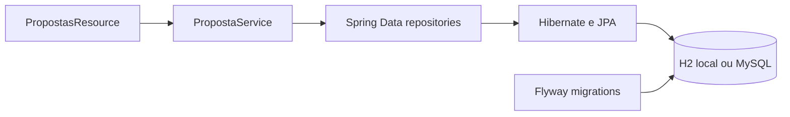

# Gabarito — Tutorial 2: JPA e persistência

Este gabarito acompanha a API da branch feature/01-rest-controllers. A etapa substitui os mapas em memória por Spring Data JPA, mantendo endpoints, DTOs e respostas HTTP. O exemplo usa H2 local e Flyway. Para um banco compartilhado, pode-se usar MySQL com perfil próprio.

**Limite da etapa:** ainda não há login. O service usa temporariamente o usuário demonstrativo de ID 1, carregado pela migration. Na etapa Spring Security, essa referência será substituída pela identidade autenticada. O valor de senha demonstrativo é apenas um marcador, não um hash nem uma credencial utilizável.

## Resultado esperado

- Propostas, catálogos e curtidas ficam em tabelas.
- A API mantém filtros, paginação de 10 propostas, DTOs e códigos HTTP.
- Flyway cria o esquema e Hibernate valida o mapeamento.



## 1. Dependências

No build.gradle, mantenha Web MVC e Validation. Acrescente:

```gradle
implementation 'org.springframework.boot:spring-boot-starter-data-jpa'
implementation 'org.springframework.boot:spring-boot-starter-flyway'
implementation 'org.flywaydb:flyway-mysql'
implementation 'org.springframework.boot:spring-boot-h2console'

runtimeOnly 'com.h2database:h2'
runtimeOnly 'com.mysql:mysql-connector-j'

testImplementation 'org.springframework.boot:spring-boot-starter-data-jpa-test'
testImplementation 'org.springframework.boot:spring-boot-starter-flyway-test'
```

O plugin Spring Boot gerencia as versões de starters e drivers. flyway-mysql fornece suporte Flyway para MySQL; H2 é o banco local de desenvolvimento. Sincronize o Gradle após salvar.

## 2. Configuração local

Substitua src/main/resources/application.yaml:

```yaml
spring:
  application:
    name: PIApi
  datasource:
    url: jdbc:h2:mem:piapi;DB_CLOSE_DELAY=-1
    username: sa
    password:
    driver-class-name: org.h2.Driver
  jpa:
    open-in-view: false
    hibernate:
      ddl-auto: validate
    properties:
      hibernate:
        format_sql: true
  flyway:
    enabled: true
  h2:
    console:
      enabled: true
      path: /h2-console
```

Flyway executa migrations ao iniciar. Hibernate valida se entidades e tabelas correspondem. Não use create ou update: o Hibernate passaria a competir com Flyway pela criação do esquema. H2 mem é apagado quando a JVM para; use H2 em arquivo ou MySQL para conservar dados entre reinicializações.

Opcionalmente, crie src/main/resources/application-mysql.yaml:

```yaml
spring:
  datasource:
    url: jdbc:mysql://localhost:3306/piapi
    username: ${DB_USER}
    password: ${DB_PASSWORD}
    driver-class-name: com.mysql.cj.jdbc.Driver
  jpa:
    open-in-view: false
    hibernate:
      ddl-auto: validate
  flyway:
    enabled: true
```

Defina DB_USER e DB_PASSWORD no ambiente local e ative o perfil mysql com SPRING_PROFILES_ACTIVE=mysql. Não grave credenciais no Git. Revise as migrations no banco escolhido antes de compartilhar o esquema.

## 3. Crie as migrations

Crie src/main/resources/db/migration/V1__criar_esquema.sql. A chave primária composta em curtida impede curtidas duplicadas até quando duas requisições chegam juntas.

```sql
CREATE TABLE usuario (
    id BIGINT AUTO_INCREMENT PRIMARY KEY,
    nome VARCHAR(120) NOT NULL,
    email VARCHAR(180) NOT NULL UNIQUE,
    senha_hash VARCHAR(255) NOT NULL,
    perfil VARCHAR(20) NOT NULL,
    ativo BOOLEAN NOT NULL DEFAULT TRUE,
    criado_em TIMESTAMP NOT NULL
);

CREATE TABLE categoria (
    id BIGINT AUTO_INCREMENT PRIMARY KEY,
    nome VARCHAR(80) NOT NULL UNIQUE,
    descricao VARCHAR(300),
    ativa BOOLEAN NOT NULL DEFAULT TRUE
);

CREATE TABLE curso (
    id BIGINT AUTO_INCREMENT PRIMARY KEY,
    nome VARCHAR(120) NOT NULL UNIQUE,
    sigla VARCHAR(20) UNIQUE,
    ativo BOOLEAN NOT NULL DEFAULT TRUE
);

CREATE TABLE publico_alvo (
    id BIGINT AUTO_INCREMENT PRIMARY KEY,
    nome VARCHAR(100) NOT NULL UNIQUE,
    descricao VARCHAR(300),
    ativo BOOLEAN NOT NULL DEFAULT TRUE
);

CREATE TABLE proposta (
    id BIGINT AUTO_INCREMENT PRIMARY KEY,
    titulo VARCHAR(120) NOT NULL,
    resumo VARCHAR(300) NOT NULL,
    descricao VARCHAR(10000) NOT NULL,
    status VARCHAR(20) NOT NULL,
    autor_id BIGINT NOT NULL,
    categoria_id BIGINT NOT NULL,
    criada_em TIMESTAMP NOT NULL,
    atualizada_em TIMESTAMP NOT NULL,
    CONSTRAINT fk_proposta_autor FOREIGN KEY (autor_id) REFERENCES usuario(id),
    CONSTRAINT fk_proposta_categoria FOREIGN KEY (categoria_id) REFERENCES categoria(id)
);

CREATE TABLE proposta_curso (
    proposta_id BIGINT NOT NULL,
    curso_id BIGINT NOT NULL,
    PRIMARY KEY (proposta_id, curso_id),
    FOREIGN KEY (proposta_id) REFERENCES proposta(id),
    FOREIGN KEY (curso_id) REFERENCES curso(id)
);

CREATE TABLE proposta_publico_alvo (
    proposta_id BIGINT NOT NULL,
    publico_alvo_id BIGINT NOT NULL,
    PRIMARY KEY (proposta_id, publico_alvo_id),
    FOREIGN KEY (proposta_id) REFERENCES proposta(id),
    FOREIGN KEY (publico_alvo_id) REFERENCES publico_alvo(id)
);

CREATE TABLE curtida (
    usuario_id BIGINT NOT NULL,
    proposta_id BIGINT NOT NULL,
    criada_em TIMESTAMP NOT NULL,
    PRIMARY KEY (usuario_id, proposta_id),
    FOREIGN KEY (usuario_id) REFERENCES usuario(id),
    FOREIGN KEY (proposta_id) REFERENCES proposta(id)
);

CREATE INDEX idx_proposta_status_data ON proposta(status, criada_em);
CREATE INDEX idx_proposta_categoria ON proposta(categoria_id);
```

Crie V2__dados_iniciais.sql para popular o usuário temporário e os catálogos. Os cursos abaixo são os cursos de graduação descritos na página institucional da [Fatec Araras](https://fatecararas.cps.sp.gov.br/sobre-a-fatec-araras/); atualize a carga inicial se a unidade alterar a lista de cursos ativos.

```sql
INSERT INTO usuario (id, nome, email, senha_hash, perfil, ativo, criado_em)
VALUES (1, 'Usuário de demonstração', 'demo@fatec.local',
        'PENDENTE-ETAPA-SEGURANCA', 'USER', TRUE, CURRENT_TIMESTAMP);

INSERT INTO categoria (id, nome, descricao) VALUES
(1, 'Tecnologia e inovação', 'Soluções digitais e novos produtos.'),
(2, 'Sustentabilidade', 'Soluções ambientais e uso responsável de recursos.'),
(3, 'Empreendedorismo', 'Soluções para negócios e desenvolvimento local.'),
(4, 'Inclusão e cidadania', 'Soluções para participação social e acessibilidade.');

INSERT INTO curso (id, nome, sigla) VALUES
(1, 'Desenvolvimento de Software Multiplataforma', 'DSM'),
(2, 'Gestão Empresarial', 'GE'),
(3, 'Sistemas para Internet', 'SI');

INSERT INTO publico_alvo (id, nome, descricao) VALUES
(1, 'Comunidade local', 'Moradores e organizações da região.'),
(2, 'Pequenos produtores', 'Pequenos produtores e cooperativas locais.'),
(3, 'Pequenos negócios', 'Microempreendedores e empresas de pequeno porte.'),
(4, 'Estudantes', 'Estudantes de escolas e instituições de ensino.');
```

PENDENTE-ETAPA-SEGURANCA é somente um marcador para a etapa sem login. Não use essa conta em produção nem aceite-a como senha. A etapa Spring Security cria contas com senha codificada por PasswordEncoder. Crie uma proposta pelo POST da coleção e atualize a variável proposta_id com o identificador retornado.

## 4. Mapeie as entidades

Crie o pacote br.com.fatecararas.piapi.domain.entity. O record Proposta da etapa 01 será substituído por uma entidade JPA. StatusProposta permanece no pacote domain. As entidades são detalhes de persistência; os services convertem entidades em DTOs antes de responder HTTP.

Lombok já está no projeto. Use @Getter e @Setter para evitar código repetitivo. Evite @Data em entidades relacionadas: equals/toString podem percorrer relações lazy e formar ciclos.

### Usuario e PerfilUsuario

```java
// domain/PerfilUsuario.java
package br.com.fatecararas.piapi.domain;
public enum PerfilUsuario { USER, ADMIN }

// domain/entity/Usuario.java
package br.com.fatecararas.piapi.domain.entity;

import br.com.fatecararas.piapi.domain.PerfilUsuario;
import jakarta.persistence.*;
import lombok.Getter;
import lombok.NoArgsConstructor;
import lombok.Setter;
import java.time.Instant;

@Entity
@Table(name = "usuario")
@Getter @Setter @NoArgsConstructor
public class Usuario {
    @Id @GeneratedValue(strategy = GenerationType.IDENTITY)
    private Long id;

    @Column(nullable = false, length = 120)
    private String nome;

    @Column(nullable = false, unique = true, length = 180)
    private String email;

    @Column(name = "senha_hash", nullable = false)
    private String senhaHash;

    @Enumerated(EnumType.STRING)
    @Column(nullable = false, length = 20)
    private PerfilUsuario perfil = PerfilUsuario.USER;

    @Column(nullable = false)
    private boolean ativo = true;

    @Column(name = "criado_em", nullable = false)
    private Instant criadoEm;

    @PrePersist
    void antesDeInserir() {
        if (criadoEm == null) criadoEm = Instant.now();
        if (perfil == null) perfil = PerfilUsuario.USER;
    }
}
```

### Categoria, Curso e PublicoAlvo

As opções são controladas e compartilhadas. Exemplo completo de Categoria:

```java
package br.com.fatecararas.piapi.domain.entity;

import jakarta.persistence.*;
import lombok.Getter;
import lombok.NoArgsConstructor;
import lombok.Setter;

@Entity
@Table(name = "categoria")
@Getter @Setter @NoArgsConstructor
public class Categoria {
    @Id @GeneratedValue(strategy = GenerationType.IDENTITY)
    private Long id;

    @Column(nullable = false, unique = true, length = 80)
    private String nome;

    @Column(length = 300)
    private String descricao;

    @Column(nullable = false)
    private boolean ativa = true;
}
```

Crie Curso com nome (120), sigla (20, única quando informada) e ativo. Crie PublicoAlvo com nome (100), descricao (300) e ativo. Ambas usam @Entity, @Table, @Id, @GeneratedValue(IDENTITY) e @Column de acordo com V1. Faça getters e setters para os campos; os métodos findBy...TrueOrderByNomeAsc dos repositories dependerão dos nomes booleanos ativa/ativo.

### Proposta

Substitua o record domain.Proposta por domain.entity.Proposta:

```java
package br.com.fatecararas.piapi.domain.entity;

import br.com.fatecararas.piapi.domain.StatusProposta;
import jakarta.persistence.*;
import lombok.Getter;
import lombok.NoArgsConstructor;
import lombok.Setter;
import java.time.Instant;
import java.util.HashSet;
import java.util.Set;

@Entity
@Table(name = "proposta")
@Getter @Setter @NoArgsConstructor
public class Proposta {
    @Id @GeneratedValue(strategy = GenerationType.IDENTITY)
    private Long id;

    @Column(nullable = false, length = 120)
    private String titulo;

    @Column(nullable = false, length = 300)
    private String resumo;

    @Column(nullable = false, length = 10000)
    private String descricao;

    @Enumerated(EnumType.STRING)
    @Column(nullable = false, length = 20)
    private StatusProposta status = StatusProposta.PUBLICADA;

    @ManyToOne(fetch = FetchType.LAZY, optional = false)
    @JoinColumn(name = "autor_id", nullable = false)
    private Usuario autor;

    @ManyToOne(fetch = FetchType.LAZY, optional = false)
    @JoinColumn(name = "categoria_id", nullable = false)
    private Categoria categoria;

    @ManyToMany
    @JoinTable(name = "proposta_curso",
        joinColumns = @JoinColumn(name = "proposta_id"),
        inverseJoinColumns = @JoinColumn(name = "curso_id"))
    private Set<Curso> cursos = new HashSet<>();

    @ManyToMany
    @JoinTable(name = "proposta_publico_alvo",
        joinColumns = @JoinColumn(name = "proposta_id"),
        inverseJoinColumns = @JoinColumn(name = "publico_alvo_id"))
    private Set<PublicoAlvo> publicosAlvo = new HashSet<>();

    @Column(name = "criada_em", nullable = false, updatable = false)
    private Instant criadaEm;

    @Column(name = "atualizada_em", nullable = false)
    private Instant atualizadaEm;

    @PrePersist
    void antesDeInserir() {
        Instant agora = Instant.now();
        criadaEm = agora;
        atualizadaEm = agora;
        if (status == null) status = StatusProposta.PUBLICADA;
    }

    @PreUpdate
    void antesDeAtualizar() {
        atualizadaEm = Instant.now();
    }
}
```

@ManyToOne representa autor e categoria; @ManyToMany usa tabelas de junção. Não use CascadeType.REMOVE para dados compartilhados: arquivar uma proposta não deve apagar cursos, categorias ou públicos-alvo.

### Curtida com chave composta

Crie CurtidaId:

```java
package br.com.fatecararas.piapi.domain.entity;

import jakarta.persistence.Embeddable;
import lombok.AllArgsConstructor;
import lombok.EqualsAndHashCode;
import lombok.Getter;
import lombok.NoArgsConstructor;
import lombok.Setter;
import java.io.Serializable;

@Embeddable
@Getter @Setter @NoArgsConstructor @AllArgsConstructor @EqualsAndHashCode
public class CurtidaId implements Serializable {
    private Long usuarioId;
    private Long propostaId;
}
```

E a entidade:

```java
package br.com.fatecararas.piapi.domain.entity;

import jakarta.persistence.*;
import lombok.Getter;
import lombok.NoArgsConstructor;
import java.time.Instant;

@Entity
@Table(name = "curtida")
@Getter @NoArgsConstructor
public class Curtida {
    @EmbeddedId
    private CurtidaId id;

    @MapsId("usuarioId")
    @ManyToOne(fetch = FetchType.LAZY, optional = false)
    @JoinColumn(name = "usuario_id")
    private Usuario usuario;

    @MapsId("propostaId")
    @ManyToOne(fetch = FetchType.LAZY, optional = false)
    @JoinColumn(name = "proposta_id")
    private Proposta proposta;

    @Column(name = "criada_em", nullable = false)
    private Instant criadaEm;

    public Curtida(Usuario usuario, Proposta proposta) {
        this.id = new CurtidaId(usuario.getId(), proposta.getId());
        this.usuario = usuario;
        this.proposta = proposta;
        this.criadaEm = Instant.now();
    }
}
```

A chave (usuario_id, proposta_id) garante uma curtida por pessoa/proposta no banco.

## 5. Repositories

Crie br.com.fatecararas.piapi.domain.repository. Cada interface deve ficar em seu próprio arquivo público. Exemplo da proposta:

```java
public interface PropostaRepository extends JpaRepository<Proposta, Long>,
        JpaSpecificationExecutor<Proposta> {}
```

Interfaces de catálogo:

```java
public interface CategoriaRepository extends JpaRepository<Categoria, Long> {
    List<Categoria> findByAtivaTrueOrderByNomeAsc();
    Optional<Categoria> findByIdAndAtivaTrue(Long id);
}

public interface CursoRepository extends JpaRepository<Curso, Long> {
    List<Curso> findByAtivoTrueOrderByNomeAsc();
}

public interface PublicoAlvoRepository extends JpaRepository<PublicoAlvo, Long> {
    List<PublicoAlvo> findByAtivoTrueOrderByNomeAsc();
    Optional<PublicoAlvo> findByIdAndAtivoTrue(Long id);
}

public interface UsuarioRepository extends JpaRepository<Usuario, Long> {}

public interface CurtidaRepository extends JpaRepository<Curtida, CurtidaId> {
    long countByIdPropostaId(Long propostaId);
}
```

Imports repetidos: JpaRepository, JpaSpecificationExecutor, entidades correspondentes, java.util.List e java.util.Optional.

## 6. Troque os services em memória

CatalogoService deve receber CategoriaRepository, CursoRepository e PublicoAlvoRepository por construtor. Troque cada List.of por uma consulta ativa e mapeie a entidade para ItemCatalogoResponse. Exemplo:

```java
public List<ItemCatalogoResponse> listarCursos() {
    return cursos.findByAtivoTrueOrderByNomeAsc().stream()
        .map(c -> new ItemCatalogoResponse(c.getId(), c.getNome(), null, c.getSigla()))
        .toList();
}

public Categoria categoriaAtiva(Long id) {
    return categorias.findByIdAndAtivaTrue(id)
        .orElseThrow(() -> new RequisicaoInvalidaException("Categoria inexistente ou inativa."));
}

public Set<Curso> cursosAtivos(List<Long> ids) {
    List<Curso> encontrados = cursos.findAllById(ids);
    long esperados = ids.stream().distinct().count();
    if (encontrados.size() != esperados || encontrados.stream().anyMatch(c -> !c.isAtivo()))
        throw new RequisicaoInvalidaException("Curso inexistente ou inativo.");
    return new HashSet<>(encontrados);
}
```

Implemente o mesmo padrão para categorias, cursos e públicos-alvo. Para listas de IDs, compare a quantidade encontrada com a quantidade de IDs distintos e rejeite registros inativos. Isso impede que um cliente associe uma opção fora dos catálogos ativos.

Em PropostaService, remova ConcurrentHashMap, AtomicLong e o seed Java. Injete PropostaRepository, UsuarioRepository, CurtidaRepository e CatalogoService. Anote métodos públicos com @Transactional; para listagem e detalhe use readOnly=true. Como relações são lazy, mapeie entidade para DTO dentro da transação.

### Listagem dinâmica com Specification

```java
@Transactional(readOnly = true)
public PaginaResponse<PropostaResponse> listar(String q, Long categoriaId,
        Long publicoAlvoId, Long cursoId, StatusProposta status, int page) {
    if (page < 0) throw new RequisicaoInvalidaException("page deve ser >= 0.");

    Specification<Proposta> filtros = (root, query, cb) -> {
        List<Predicate> c = new ArrayList<>();
        c.add(cb.equal(root.get("status"), StatusProposta.PUBLICADA));
        if (status != null) c.add(cb.equal(root.get("status"), status));

        if (q != null && !q.isBlank()) {
            String termo = "%" + q.trim().toLowerCase(Locale.ROOT) + "%";
            c.add(cb.or(
                cb.like(cb.lower(root.get("titulo")), termo),
                cb.like(cb.lower(root.get("resumo")), termo),
                cb.like(cb.lower(root.get("descricao")), termo)));
        }
        if (categoriaId != null)
            c.add(cb.equal(root.get("categoria").get("id"), categoriaId));
        if (publicoAlvoId != null) {
            Join<Proposta, PublicoAlvo> alvo = root.join("publicosAlvo");
            c.add(cb.equal(alvo.get("id"), publicoAlvoId));
        }
        if (cursoId != null) {
            Join<Proposta, Curso> curso = root.join("cursos");
            c.add(cb.equal(curso.get("id"), cursoId));
        }

        query.distinct(true);
        return cb.and(c.toArray(Predicate[]::new));
    };

    Page<Proposta> pagina = propostas.findAll(filtros,
        PageRequest.of(page, 10, Sort.by(Sort.Direction.DESC, "criadaEm")));
    List<PropostaResponse> itens = pagina.getContent().stream().map(this::paraResponse).toList();
    return new PaginaResponse<>(itens, pagina.getNumber(), 10,
        pagina.getTotalElements(), pagina.getTotalPages());
}
```

Imports do método: java.util.*, org.springframework.data.domain.*, org.springframework.data.jpa.domain.Specification e jakarta.persistence.criteria.*. Os joins são adicionados apenas quando o filtro existe. distinct(true) evita que as relações muitos-para-muitos dupliquem propostas nos resultados.

### Criar, atualizar e mapear DTO

```java
@Transactional
public PropostaResponse criar(CriarPropostaRequest r) {
    Proposta p = new Proposta();
    p.setTitulo(r.titulo());
    p.setResumo(r.resumo());
    p.setDescricao(r.descricao());
    p.setCategoria(catalogo.categoriaAtiva(r.categoriaId()));
    p.setCursos(catalogo.cursosAtivos(r.cursoIds()));
    p.setPublicosAlvo(catalogo.publicosAlvoAtivos(r.publicoAlvoIds()));
    p.setAutor(usuarios.findById(1L)
        .orElseThrow(() -> new RecursoNaoEncontradoException("Usuário demonstrativo ausente.")));
    return paraResponse(propostas.save(p));
}

@Transactional
public PropostaResponse atualizar(Long id, AtualizarPropostaRequest r) {
    Proposta p = propostas.findById(id)
        .filter(x -> x.getStatus() == StatusProposta.PUBLICADA)
        .orElseThrow(() -> new RecursoNaoEncontradoException("Proposta não encontrada."));
    p.setTitulo(r.titulo());
    p.setResumo(r.resumo());
    p.setDescricao(r.descricao());
    p.setCategoria(catalogo.categoriaAtiva(r.categoriaId()));
    p.setCursos(catalogo.cursosAtivos(r.cursoIds()));
    p.setPublicosAlvo(catalogo.publicosAlvoAtivos(r.publicoAlvoIds()));
    return paraResponse(p); // dirty checking persiste no commit
}

private PropostaResponse paraResponse(Proposta p) {
    return new PropostaResponse(p.getId(), p.getTitulo(), p.getResumo(), p.getDescricao(),
        p.getPublicosAlvo().stream().map(PublicoAlvo::getId).toList(),
        p.getCategoria().getId(), p.getCursos().stream().map(Curso::getId).toList(),
        p.getAutor().getId(), p.getAutor().getNome(), p.getStatus(),
        (int) curtidas.countByIdPropostaId(p.getId()),
        curtidas.existsById(new CurtidaId(1L, p.getId())),
        p.getCriadaEm(), p.getAtualizadaEm());
}
```

buscarPorId consulta o repository e converte ausência ou proposta arquivada em RecursoNaoEncontradoException. arquivar carrega a proposta e muda o status para ARQUIVADA; não apaga a linha. Os callbacks @PrePersist/@PreUpdate atualizam as datas.

### Curtir e remover curtida

```java
@Transactional
public PropostaResponse curtir(Long propostaId) {
    Proposta p = buscarEntidadePublicada(propostaId);
    Usuario u = usuarioDemonstracao();
    CurtidaId id = new CurtidaId(u.getId(), p.getId());
    if (!curtidas.existsById(id)) curtidas.save(new Curtida(u, p));
    return paraResponse(p);
}

@Transactional
public PropostaResponse removerCurtida(Long propostaId) {
    Proposta p = buscarEntidadePublicada(propostaId);
    Usuario u = usuarioDemonstracao();
    curtidas.deleteById(new CurtidaId(u.getId(), p.getId()));
    return paraResponse(p);
}
```

Implemente buscarEntidadePublicada e usuarioDemonstracao usando findById e as exceptions existentes. Na etapa 04, troque usuarioDemonstracao pela pessoa do principal autenticado. A constraint composta do banco continua sendo a garantia contra duplicatas concorrentes.

**Nota de desempenho:** para fins didáticos, paraResponse faz uma contagem de curtidas por proposta e pode gerar N+1 consultas numa listagem. Registre como melhoria futura; para volumes iniciais da disciplina, priorize compreender as relações e a transação.

## 7. Controller, DTOs e status HTTP

PropostasResource e CatalogosResource permanecem sem acesso direto a entidades. Continuam recebendo CriarPropostaRequest/AtualizarPropostaRequest e devolvendo PropostaResponse. Preserve @Valid e o ApiExceptionHandler da etapa 01.

- Criar: 201 Created, corpo da proposta e cabeçalho Location.
- Consultar/atualizar: 200 OK.
- ID inexistente ou proposta arquivada na leitura: 404 Not Found.
- Arquivar: 204 No Content e status ARQUIVADA.
- JSON inválido ou referência de catálogo inexistente/inativa: 400 Bad Request.

## 8. Roteiro de aula

1. Acrescente dependências e configuração H2.
2. Crie V1/V2 e as entidades; confira no log Flyway e validação do Hibernate.
3. Crie repositories e substitua as listas do CatalogoService; consulte categorias, cursos e públicos-alvo.
4. Substitua os mapas no PropostaService. Crie pelo POST do Insomnia e copie o ID retornado.
5. Consulte por ID e liste com q, categoriaId, cursoId e publicoAlvoId. Tente páginas 0 e 1.
6. Curta a mesma proposta duas vezes; a quantidade deve permanecer 1. Remova a curtida e confirme 0.
7. Atualize e arquive. Uma proposta arquivada não aparece na listagem pública.
8. Reinicie a aplicação. H2 em memória perde os dados após a JVM parar; H2 em arquivo/MySQL conserva-os.

## Erros comuns

- Hibernate falha no validate: alinhe nulabilidade, tamanho, nome e tipo das colunas entre migration e entidade.
- Tabela não encontrada: confira pasta db/migration, prefixo V1__/V2__ e log do Flyway.
- Tabelas são criadas duas vezes: use ddl-auto: validate; não misture criação automática e migrations.
- Relação lazy falha no mapeamento: construa DTOs dentro de método @Transactional; mantenha open-in-view: false.
- Curtidas duplicam: preserve a chave primária composta.
- DELETE apaga dados relacionados: a proposta deve ser arquivada; não use cascata de remoção em catálogos.

Na implementação ao vivo, registre commits pequenos: dependências/configuração; entidades/migrations; repositories/catálogos; CRUD e filtros; curtidas. A etapa seguinte adiciona login e substitui o usuário demonstrativo pela identidade autenticada.

## Apêndice: classes e helpers completos

Use estes arquivos de referência para preencher as duas entidades de catálogo descritas na seção 4. Ambos seguem a migration V1.

### Curso.java

```java
package br.com.fatecararas.piapi.domain.entity;

import jakarta.persistence.*;
import lombok.Getter;
import lombok.NoArgsConstructor;
import lombok.Setter;

@Entity
@Table(name = "curso")
@Getter @Setter @NoArgsConstructor
public class Curso {
    @Id
    @GeneratedValue(strategy = GenerationType.IDENTITY)
    private Long id;

    @Column(nullable = false, unique = true, length = 120)
    private String nome;

    @Column(unique = true, length = 20)
    private String sigla;

    @Column(nullable = false)
    private boolean ativo = true;
}
```

### PublicoAlvo.java

```java
package br.com.fatecararas.piapi.domain.entity;

import jakarta.persistence.*;
import lombok.Getter;
import lombok.NoArgsConstructor;
import lombok.Setter;

@Entity
@Table(name = "publico_alvo")
@Getter @Setter @NoArgsConstructor
public class PublicoAlvo {
    @Id
    @GeneratedValue(strategy = GenerationType.IDENTITY)
    private Long id;

    @Column(nullable = false, unique = true, length = 100)
    private String nome;

    @Column(length = 300)
    private String descricao;

    @Column(nullable = false)
    private boolean ativo = true;
}
```

### Helpers do CatalogoService

Além de cursosAtivos e categoriaAtiva, use as buscas unitárias abaixo para resolver os filtros. O método que lista categorias e o de públicos-alvo seguem a mesma conversão usada em listarCursos.

```java
public Curso cursoAtivo(Long id) {
    return cursos.findById(id).filter(Curso::isAtivo)
        .orElseThrow(() -> new RequisicaoInvalidaException("Curso inexistente ou inativo."));
}

public PublicoAlvo publicoAlvoAtivo(Long id) {
    return publicos.findByIdAndAtivoTrue(id)
        .orElseThrow(() -> new RequisicaoInvalidaException("Público-alvo inexistente ou inativo."));
}

public Set<PublicoAlvo> publicosAlvoAtivos(List<Long> ids) {
    List<PublicoAlvo> encontrados = publicos.findAllById(ids);
    long esperados = ids.stream().distinct().count();
    if (encontrados.size() != esperados || encontrados.stream().anyMatch(p -> !p.isAtivo())) {
        throw new RequisicaoInvalidaException("Público-alvo inexistente ou inativo.");
    }
    return new HashSet<>(encontrados);
}
```

Para completar CatalogoService, aplique o mesmo padrão de map ao retorno de cada repository. Os imports dos helpers são Set, HashSet e List; injete repositories por construtor.

### Helpers de leitura e arquivamento no PropostaService

```java
@Transactional(readOnly = true)
public PropostaResponse buscarPorId(Long id) {
    Proposta p = propostas.findById(id)
        .filter(x -> x.getStatus() == StatusProposta.PUBLICADA)
        .orElseThrow(() -> new RecursoNaoEncontradoException("Proposta não encontrada."));
    return paraResponse(p);
}

@Transactional
public void arquivar(Long id) {
    Proposta p = propostas.findById(id)
        .orElseThrow(() -> new RecursoNaoEncontradoException("Proposta não encontrada."));
    p.setStatus(StatusProposta.ARQUIVADA);
}

private Proposta buscarEntidadePublicada(Long id) {
    return propostas.findById(id)
        .filter(x -> x.getStatus() == StatusProposta.PUBLICADA)
        .orElseThrow(() -> new RecursoNaoEncontradoException("Proposta não encontrada."));
}

private Usuario usuarioDemonstracao() {
    return usuarios.findById(1L)
        .orElseThrow(() -> new RecursoNaoEncontradoException("Usuário demonstrativo ausente."));
}
```

No método listar, após adicionar a condição para status PUBLICADA, aplique o parâmetro status quando informado. A combinação de condições significa que uma consulta pública por ARQUIVADA não revela propostas arquivadas:

```java
if (status != null) {
    c.add(cb.equal(root.get("status"), status));
}
```

Os controllers da etapa 01 já delegam para esses métodos. Não é necessário mudar as rotas para introduzir JPA.

